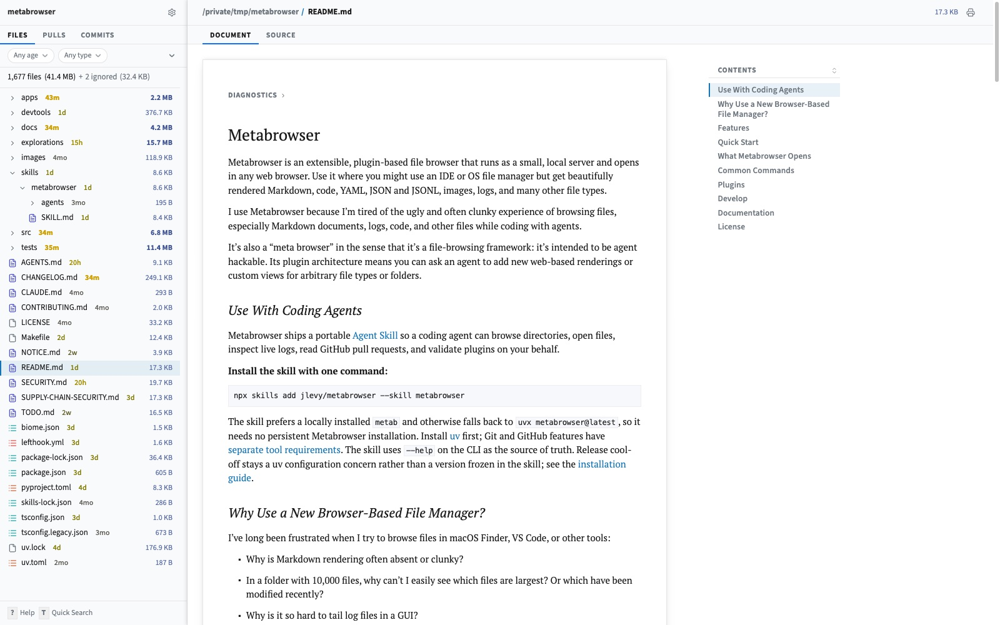

<p align="center"></p>

<h1 align="center">Metabrowser</h1>

Metabrowser is where your coding agents show you their work and where you browse it
yourself: files, Markdown, logs, data, diffs, commits, and pull requests.
It runs locally, in your own web browser or an optional native Mac app, and unlike most
file browsers, it watches files as they change and stays responsive on trees of
[hundreds of thousands of files](docs/scale-benchmark.md).
Plugins extend it to any file type, today as views and in future as editors.



## Why

I’ve long been frustrated browsing files in Finder, VS Code, and similar tools,
especially the Markdown, logs, code, and data that pile up while coding with agents.
Markdown rendering is often absent or clunky; in a folder of 10,000 files I can’t see
which are largest or newest; tailing a log or reading a large JSON, JSONL, or YAML file
is hard; and a graphical view of a new file format seems to need a whole VS Code
extension or Electron app.
Metabrowser is the tool I wanted instead, and it is now my preferred way to read
Markdown.

## Quick Start

With [uv](https://docs.astral.sh/uv/) installed, run the latest release on the current
folder, which opens in your web browser:

```shell
uvx metabrowser@latest .
```

Or install `metab` as a command, then open a folder, a file, a GitHub repository, or a
pull request:

```shell
uv tool install metabrowser
metab ~/notes
metab ~/notes/todo.md
metab https://github.com/owner/repo
metab https://github.com/owner/repo/pull/123
```

Repositories need Git, and pull requests also need a signed-in GitHub CLI (`gh`).
`metab --help` lists every mode and option.

## Installation

### Command line and web browser

Install [uv](https://docs.astral.sh/uv/getting-started/installation/) and open a new
terminal. On macOS with Homebrew, you can use `brew install uv`. Install Metabrowser and
check that the command works:

```shell
uv tool install metabrowser
metab --version
metab --doctor
```

If the shell cannot find `metab`, run `uv tool update-shell` and open a new terminal.
Use `uv tool dir --bin` to find the executable.
To update an existing uv installation of Metabrowser, run `uv tool upgrade metabrowser`.
If you installed it with pipx, run `pipx upgrade metabrowser`. If a Metabrowser
installation managed by uv is damaged, run `uv tool install --reinstall metabrowser`.
Use `metab --doctor` again after a repair.
You can run `uvx metabrowser@latest .` to open the current folder without adding a
persistent command.

Local file browsing only needs `metab`. Install [Git](https://git-scm.com/install/) for
repositories and the [GitHub CLI](https://github.com/cli/cli#installation) for pull
requests or private GitHub repositories.
On macOS with Homebrew, run `brew install git gh`. Sign in with
`gh auth login --hostname github.com` and check the active account with
`gh auth status --hostname github.com`. Run `metab --doctor` for unsupported tool
versions, sign-in problems, or trouble reading or writing the configuration and cache
directories.

### Native macOS app

The optional app requires an Apple silicon Mac with macOS 26 or later and uses the
separately installed `metab` command.
The public CLI is available from PyPI. The native app is a developer preview.
When a signed disk image appears on
[GitHub Releases](https://github.com/jlevy/metabrowser/releases), open it and drag
Metabrowser to Applications after installing a compatible `metab`.

If the app cannot start a folder, open **Settings → Runtime**. It shows the required
version and any rejected runtimes.
After installing or updating `metab`, use **Refresh** or **Choose metab…** to select the
executable. If your preview requires a newer version than
[PyPI](https://pypi.org/project/metabrowser/) offers, use the checkout’s `metab` as
described below. **Help → Check Setup…** checks the tools and paths the app actually
uses, which can differ from the ones in your terminal.
Restart an open folder’s server if the app offers to after an upgrade.
See [Choosing a metab](docs/macos-app.md#choosing-a-metab) for runtime discovery and the
app’s trust checks.

#### Developer preview

To build the preview, install Xcode 26.6 or later, uv, and
[the repository’s pinned Node version](docs/development.md#set-up).
The preview requires `metab` 0.13.0 or later.
In Terminal:

~~~shell
git clone https://github.com/jlevy/metabrowser.git
cd metabrowser
make install
make macos-app
~~~

Open the app at the path printed by the build.
To use the checkout’s runtime, select its `.venv/bin/metab` in **Settings → Runtime →
Choose metab…**. If the build fails or the runtime is rejected, check the
[development prerequisites](docs/development.md#set-up) and
[preview setup guide](docs/installation.md#the-macos-app) for the checkout and version
the app expects.

### Plugins and agent skill

Use `metab --plugins` to list discovered plugins with their sources and dependencies, or
add `--json` to read that report programmatically.
The Mac app lists the selected runtime’s plugins under **Settings → Plugins**, with any
discovery errors; `metab --doctor` reports them too.
Built-in plugins ship with `metab`. For external plugins, see
[plugin discovery and dependency checks](docs/plugins.md#trust-model-and-discovery).

To give a coding agent the Metabrowser skill, run
`npx skills add jlevy/metabrowser --skill metabrowser`, then check that the agent can
run `metab --version`. The skill uses the same CLI installation described here.
See [Working with agents](docs/working-with-agents.md) for usage.

[Detailed installation and requirements](docs/installation.md) covers version pinning,
GitHub access, and the developer preview.

## What You Can Do

- **Read any file:** Markdown rendered by [KPress](https://github.com/jlevy/kpress)
  beside its source, JSON and YAML as trees, JSONL as event logs, code, logs, images,
  and HTML in a sandboxed preview.
  Each folder opens with an Overview of its file types and a Treemap of its sizes.
  See [browsing files](docs/browsing-files.md).
- **Watch files and logs live:** the tree and folder totals update as files change, and
  an open JSONL log that is still being written shows new events as they arrive.
  See [browsing files](docs/browsing-files.md).
- **Browse commits and diffs:** the Commits tab lists a repository’s history, and each
  commit has its own page with per-file diffs.
  See [browsing history](docs/browsing-history.md).
- **Review pull requests:** open a pull-request URL, or the Pulls tab of a GitHub
  repository, to read its conversation, reviews, inline comments, checks, stack, and
  changes, online or offline from the cache.
  See [reviewing pull requests](docs/reviewing-pull-requests.md).
- **Find anything from the keyboard:** Quick Search finds files by name or path and, in
  a GitHub repository, pull requests by number or title; single-key shortcuts move
  between tabs, views, and rows, and `0` goes home.
  See [keyboard shortcuts](docs/keyboard-shortcuts.md).
- **Work with coding agents:** the `metabrowser` agent skill lets an agent open a
  folder, file, or pull request and hand you the page, and coding-agent session logs
  open as timelines. See [working with agents](docs/working-with-agents.md).
- **Browse a remote machine:** `metab --remote HOST --path DIR` starts Metabrowser on a
  host over SSH and tunnels it to your browser.
  See [browsing files](docs/browsing-files.md).
- **Script it:** `--api` issues any route the browser reads, `--show` reports what the
  browser would do with one file, `--walk` dumps the inventory, and `--diff` prints a
  change set, all without a browser or a listening port.
  See the [command line](docs/command-line.md).

## The Mac App

The optional macOS app opens each folder in its own window, with recent items, session
restore, and folders dropped on its Dock icon.
It runs the `metab` you installed, so it shows the same pages.
See [the Mac app guide](docs/macos-app.md) for using it and
[Installation](#installation) for setup and troubleshooting.

## Scale

Metabrowser indexes a tree in the background, so the first view does not wait for a full
crawl. [The scale benchmark](docs/scale-benchmark.md) measures how soon a large tree
shows counts, how long its scan takes, and the server’s memory, on a corpus anyone can
regenerate. Indexing stops at 500,000 files; browsing larger trees is planned (see
Direction).

## Extend It

Each view of a file, folder, or pull request comes from a plugin: a manifest that
matches files and adds browser views, with optional Python data hooks.
[Plugin authoring](docs/plugins.md) is the reference, and
[the plugin system](docs/project/architecture/arch-plugin-system.md) explains how
plugins load and how to add a file type.

## Security

> [!WARNING]
> Metabrowser is a local tool for trusted users, not a public web server.
> It listens only on your own machine by default; load only plugins you trust, and never
> expose it to the internet.
> See the [security policy](SECURITY.md).

## Direction

Planned work, each linked to its plan:

- **The Mac app and agents:** a signed, notarized download, and a `metab --present` that
  the app answers and that falls back to a browser when there is no app; today it hands
  a target to the app alone
  ([native macOS app plan](docs/project/specs/active/plan-2026-11-10-native-macos-app.md))
- **Editing:** opt-in editing of trusted local files
  ([trusted-local editing plan](docs/project/specs/active/plan-2026-07-16-trusted-local-file-editing.md))
- **Larger trees:** a faster native inventory engine behind the existing provider
  contract
  ([inventory provider plan](docs/project/specs/active/plan-2026-08-23-inventory-provider-refactor-and-fdu-adoption.md)),
  and million-file trees browsed, not cut off
  ([load-time plan](docs/project/specs/active/plan-2026-08-21-load-time-performance.md))
- **Working-tree status and diffs**
  ([Git status plan](docs/project/specs/active/plan-2026-08-26-git-status-and-working-tree-diffs.md))

## Documentation

Using Metabrowser:

- [Installation](docs/installation.md): `metab`, the Mac app, the skill, and
  requirements
- [Browsing files](docs/browsing-files.md): the Files tab, live updates, and remote
  hosts
- [Browsing history](docs/browsing-history.md): the Commits tab, commits, and diffs
- [Reviewing pull requests](docs/reviewing-pull-requests.md): the Pulls tab and pages
- [Working with agents](docs/working-with-agents.md): the skill and agent-log timelines
- [The Mac app](docs/macos-app.md): windows, recent items, and restore
- [Keyboard shortcuts](docs/keyboard-shortcuts.md): every shortcut
- [Command line](docs/command-line.md): every mode, option, and environment variable
- [Scale benchmark](docs/scale-benchmark.md): what it measures and how to run it
- [Changelog](CHANGELOG.md) and [roadmap](TODO.md)

Extending it:

- [Plugin authoring](docs/plugins.md): the manifest, browser SDK, and data hooks
- [Adding a language](docs/adding-a-language.md): a programming language’s family,
  color, and syntax highlighting, from upstream sources
- [Architecture](docs/architecture.md): the layers and every architecture document
- [Design system](docs/design-system.md): tokens, components, and interaction design
- [Reader messages](docs/design-system-messages.md): what notices, empty states, and
  errors may say
- [File Rollup Format](docs/project/architecture/file-rollup-format/file-rollup-format.md)
  and [File Diff Format](docs/project/architecture/file-diff-format/file-diff-format.md)
  specifications

Working on it:

- [Contributing](CONTRIBUTING.md): how to propose and land a change
- [Development](docs/development.md): setup, tool versions, and the `make verify` gate
- [End-to-end testing](docs/e2e-testing.md): which test layer proves what
- [Publishing](docs/publishing.md): the tag-driven release path
- [Building the Mac app](apps/macos/README.md): build, test, and release the app
- Standards: [rendering large content](docs/large-content-rendering.md),
  [web performance](docs/web-performance-framework.md),
  [real-time debugging](docs/realtime-debugging.md), and the
  [engine performance model](docs/engine-performance-model.md)
- [Project records](docs/project/README.md): specs, research, and architecture

Policies:

- [Security policy](SECURITY.md): reporting, the served-root boundary, and trust
- [Supply-chain security](SUPPLY-CHAIN-SECURITY.md): dependency review and cool-off

## Contributing

See [Contributing](CONTRIBUTING.md) and [Development](docs/development.md).

## License

AGPL-3.0-or-later; see [LICENSE](LICENSE). [NOTICE.md](NOTICE.md) lists vendored
components and their licenses.

<!-- This document follows common-doc-guidelines.md.
See github.com/jlevy/practical-prose and review guidelines before editing.
-->
