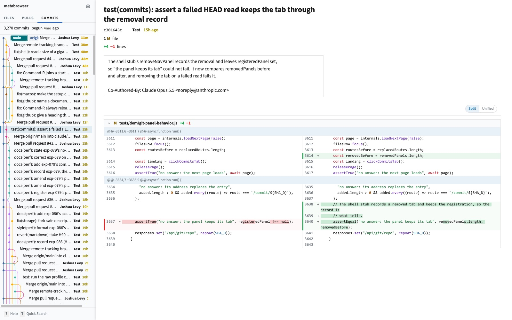

# Browsing History

The Commits tab shows a repository’s history as a commit graph.
Each commit opens at its own address with its summary and its diff, and the same change
sets are available from a terminal with `--diff`.



Reading history needs Git; [installation](installation.md#git-and-github-setup) says
which tools each feature needs.

## The Commits Tab

Choose **Commits** beside Files and Pulls, or press `H`. The tab appears when the served
folder is the root of a Git repository or of a linked worktree, and on any repository
opened by its URL. A folder inside a repository has no Commits tab, because history
covers files outside what that folder serves.

The graph lists, newest first in topological order:

- **For a folder:** the commits reachable from `HEAD`, its upstream, and the trunk
  branches `main` and `master`, locally and on `origin`.
- **For a repository URL:** the history of the commit the server is pinned to.

Each row is the graph, the commit’s branch and tag chips, its subject, its author, and
its age. The header counts the commits and says when the first one was made.
More history loads as you scroll.
Hover a row to see a summary card with the commit’s change counts.

Switching to Commits selects the newest commit.
Click a row, or move with `J` and `K` or the arrow keys, to select another; Enter and
Space select the focused row.
The selected commit opens in the main pane, and the address becomes that commit’s page.

When you come back to Commits after `HEAD` has moved, as after a checkout or a commit,
the graph reloads. If branches move while you scroll an open list, the list says
**History changed since this list loaded.** and offers **Reload history**.

## A Commit’s Page

Every commit has an address, `/commit/<id>`, with its full 40- or 64-character ID. Share
or bookmark it to come back to that commit; a short ID or a branch name in the address
shows **Full commit ID needed** instead.

The page begins with the commit’s summary, laid out as a pull request’s header is:

- the subject
- the author, with a person icon where a pull request shows the author’s avatar
- the short ID with a copy control, and the commit’s branches and tags
- “Committed” and the age
- the **Diff summary**, on every commit, one file or many: the files changed, counted by
  status, and the lines added and deleted; it starts collapsed and opens into the tree
  of changed files, where a file takes you to its diff
- the full commit message, when there is more than a subject

Below it is the diff against the commit’s first parent, one section per file with its
`+N` and `−N` counts.
Click a file’s bar to collapse it.
The diff draws **Split** or **Unified**; press `L` or use the layout control to switch,
and a pane too narrow for Split draws Unified until there is room.
Large files load as you reach them, and a commit that changes more files than the page
lists says that its diff is bounded.

On a repository opened by its URL, each file’s bar also offers **View file**, which
opens the file the commit made, at the commit, switching the served commit first when
the page shows another; a deleted file has none.

A repository URL serves a mirror of the repository (see
[the command line](command-line.md#serving-a-git-source)), which holds what its last
fetch brought. A commit address the mirror does not have yet starts a fetch when the
mirror is older than its freshness window, and the page opens the commit if the fetch
brings it. Otherwise the page says the commit is not in the mirror and offers **Retry**.

## Branches and Tags of a Repository URL

A repository opened by its URL is pinned to one commit, its default branch’s unless the
URL names another. The button under the navigation header names the served branch, tag,
pull request, or commit; click it or press `W` to switch.

It lists the mirror’s branches, default first, or its tags, newest first, and the filter
box narrows either list by name.
Choosing one serves it and reloads the page on the same file or folder when the new
commit has it, or at the root when it does not.
The switch lasts until the server stops.

The foot of the navigation pane says when the mirror was last fetched from its origin;
click it to fetch now.
A fetch never moves the page under you: when it moves the served branch, the foot offers
the new commit, and **Switch** serves it.

## Branches and Tags of a Local Checkout

A folder that is a repository’s root has the same button, and opens on **Working tree**:
the files on disk, with whatever you have edited, staged, or not yet added.
Click it or press `W` to see any other branch or tag without checking it out.

- **Working tree** is the first row, and the only one that shows your live files.
- **Branches** are the checkout’s own, with the one you have checked out first and
  marked “checked out”.
  **Tags** are its tags, newest first.
  **Remotes** are its remote-tracking branches, such as `origin/main`, as your last
  fetch left them.
- Choosing a branch or tag shows its last commit, read from the repository’s Git
  objects. The button and the navigation header then name it, with its short commit.
  This includes the checked-out branch: choosing it shows what is committed, without
  your uncommitted changes, and **Working tree** is the way back to them.

Nothing is checked out, fetched, or written.
Your working tree, your index, and `HEAD` stay exactly as they are, so it is safe with
work in progress, and Git commands in a terminal are unaffected.

A branch or tag is shown the way a repository opened by its URL is.
It is read-only and runs under the untrusted profile, whatever the folder was opened
with, because another branch holds whatever a fetch brought: Markdown is rendered inert
and an HTML file shows only its source.
It has no Recent tab, live updates, ignored files, or Pulls tab; those belong to the
working tree, which gets the folder’s own profile back.

The choice is the server’s, so it holds for every tab until you choose **Working tree**
again or the server stops.
`metab <folder>` starts on the working tree, and `metab <folder> --ref <name>` starts on
that branch or tag
([the command line](command-line.md#a-branch-or-tag-of-a-local-checkout)). A tab left on
the other one says so and offers **Reload**. Metabrowser fetches nothing into a
checkout, so a remote-tracking branch is only as new as your own last `git fetch`, and a
branch that moves while it is shown is shown at its new commit when you choose it again.
The button follows the folder you opened: it is there when that folder is a repository’s
root, as the Commits tab is.

Showing a branch or tag needs a Git as recent as cloning does
([installation](installation.md#git-and-github-setup)), and in a partial clone, one made
with `git clone --filter`, a newer one still.
With an older one the list says which release it needs, and the working tree and its
Commits tab work as before.

## Diffs from a Terminal

`--diff` prints a change set of a local repository without a browser:

```shell
metab ./repo --diff main..feature      # from main to feature, directly
metab ./repo --diff main...feature     # from their merge base, as a pull request does
metab ./repo --diff <revision>         # one commit against its first parent
metab ./repo --diff changes.patch      # a .patch or .diff file under ROOT
```

The text report names the comparison, its two ends, the totals, and one line per file:

```text
comparison git:45fa118cac607080 (first_parent)
left  f11ba44cc886f0446daf7757727515e276d7a96c
right 60429cd1ba18245a840d3e7460a0f4777ce58544
files 1  +8 -7  (exact)
M    docs/project/specs/active/plan-2026-11-14-documentation-from-first-principles.md  [+8 -7]
```

- **`--format json`** prints the whole change set as a
  [File Diff Format](project/architecture/file-diff-format/file-diff-format.md)
  document, the same data the page draws.
- **`--diff-patch PATH`** prints one changed file’s hunks.
- **`--diff-check`** rebuilds the target tree from the base tree and the change set, and
  compares the two tree hashes.
  It prints both and `apply: clean`, or `apply: MISMATCH` with exit status 1. It needs a
  comparison of two commits, not a patch file.

A spec that does not resolve, or a file name that is not in the comparison, prints a
`diff error:` line and exits with status 2.

`--diff` reads a local checkout only.
For a repository opened by its URL, or for any range from a script, issue the comparison
route that the page itself uses:

```shell
metab https://github.com/owner/repo --api '/api/plugin/diff/comparison?left=v1.0&right=origin/main'
metab ./repo --api '/api/plugin/diff/comparison?left=main&right=feature&base_policy=merge_base'
```

In a mirror, a branch is named as its origin’s, `origin/<branch>`.

The history the tab draws is also data:

```shell
metab ./repo --api '/api/git/log?limit=20'           # the newest 20 commits
metab ./repo --api '/api/git/log?scope=all'          # every branch and tag
metab ./repo --api /api/git/refs                     # branches and tags
metab ./repo --show /commit/<revision>               # a commit's change set
metab ./repo --show /commit/<revision>/README.md     # one file in it
```

`--show` accepts any revision Git resolves, such as `HEAD~2` or a tag; the page’s
address takes a full commit ID. [The command-line guide](command-line.md) has every
option.

## What It Does Not Do Yet

- **Uncommitted changes:** the Commits tab shows commits only.
  Working-tree status and diffs are planned in the
  [Git status plan](project/specs/active/plan-2026-08-26-git-status-and-working-tree-diffs.md).
- **Ranges in the browser:** a page shows one commit against its first parent, or a pull
  request’s Changes. A range of commits is a terminal command.
- **A folder inside a repository:** it has no Commits tab and no branch button, which
  belong to a repository’s root.
  Opening such a folder at its repository’s root is planned in
  [Open Modes](project/architecture/arch-open-modes.md).
- **Pull requests on a branch of a local checkout:** the Pulls tab belongs to the
  working tree.

<!-- This document follows common-doc-guidelines.md.
See github.com/jlevy/practical-prose and review guidelines before editing.
-->
