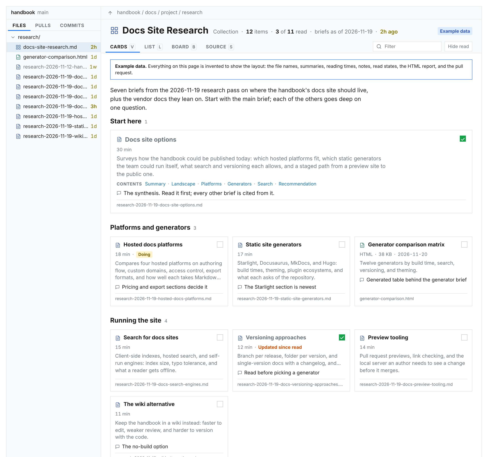
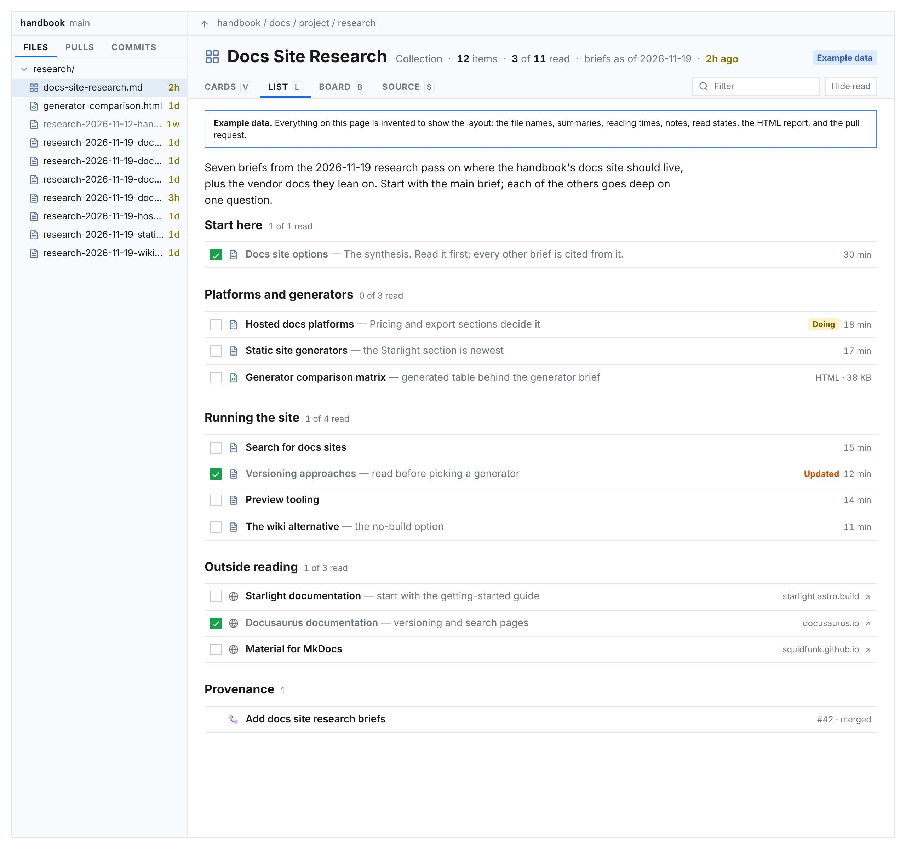
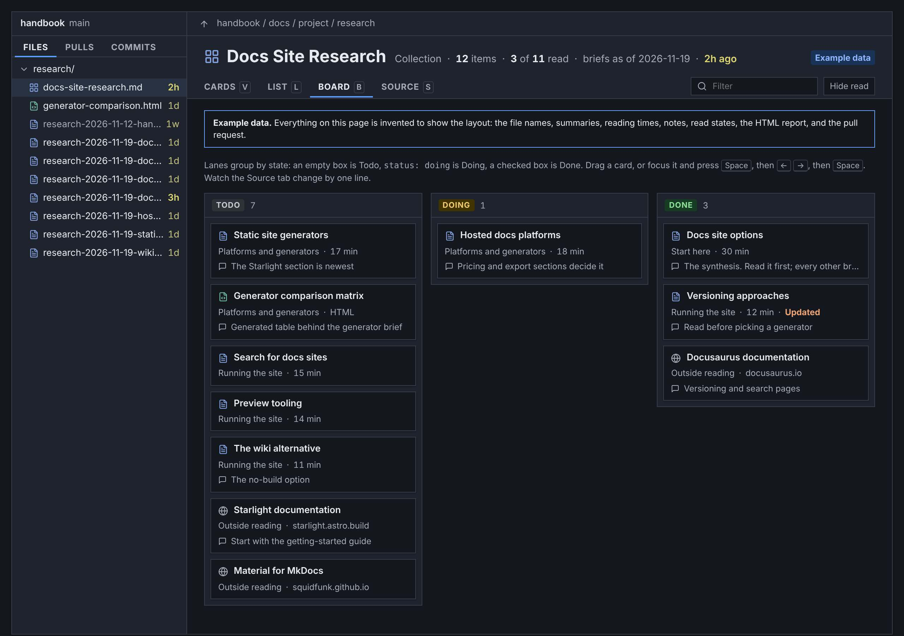
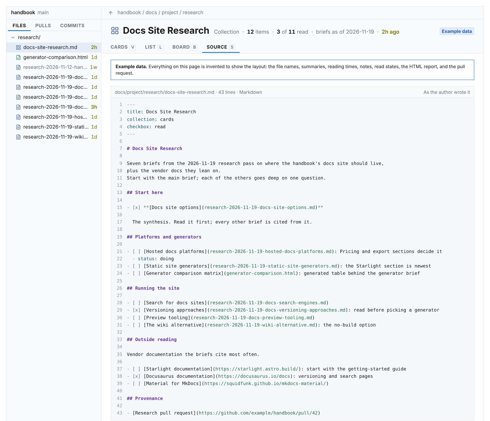

# Research: Design Memo for Collection Documents

**Date:** 2026-11-20

**Author:** Independent designer (LLM-assisted)

**Status:** Complete.
One designer’s recommendations; nothing is decided.

## Overview

This memo is the design review of the first draft of
[Collection Documents](research-2026-11-20-collection-documents.md).
It looks at the format from the reader’s and the author’s side: how the raw file reads,
what a card shows, how the layouts relate, and how the page behaves.

Its recommendations are options.
The [technical review](../reviews/review-2026-11-20-collection-documents-technical.md)
disagrees with some of them, and
[Where the Reviews Disagree](#where-the-reviews-disagree) lists each case.
The brief weighs both.

A mockup shows the design with example data:
[collection-mockup.html](assets/collection-documents/collection-mockup.html), a
self-contained page with Cards, List, Board, and Source tabs.
All of its data is invented: the file names, summaries, reading times, notes, and read
states.



## Summary

The draft’s core bet is right: a Markdown link list with headings is already a
dashboard, and the file should stay something GitHub renders well and an agent writes
without instructions.
This memo tightens the syntax so the frontmatter never has to grow, moves the remaining
configuration into conventions a reader can see in the body, and makes four product
calls:

1. **One flat trigger, no view config.** `collection: cards` picks the default tab and
   nothing else. Every layout is always available as a tab, so the draft’s `views:` list
   goes away.
2. **Prominence and notes are Markdown, not keys.** A bold link is featured; an indented
   paragraph under an item is its note.
3. **Two families of layout.** Reading layouts (Cards, List) keep the author’s prose and
   order and replace the Document tab.
   Working layouts (Board, Table) regroup items by a field and drop the prose.
4. **The collection becomes a reading context.** Opening an item from it gives Control-N
   and Control-P through the collection, which is the single biggest time-saver for the
   seven-brief review.

## Authoring Ergonomics

### Critique of the Draft, by Reader

**A human skimming the raw file.** The Markdown face reads well: headings, bullets,
links, and a short note after a colon.
Two things hurt. First, the configuration form (Principle 2) nests a flow mapping inside
a list inside a mapping (`- cards: {fields: [as_of, words], featured: "Main brief"}`);
nobody reads that at a glance.
Second, `featured: "Main brief"` points at a heading by its text, so renaming the
heading silently un-features the item, and nothing in the body tells the skimmer which
item is featured.

**An agent writing cold.** An agent asked to “make an index of these briefs” will
produce headings and bullet links unprompted.
What it cannot guess is the trigger, and what it gets wrong is anything polymorphic:
`collection:` is a scalar in Principle 1 and a mapping in Principle 2, so adding one
option means restructuring the frontmatter.
Agents also guess values: expect `collection: true`, `collection: reading-list`, and
`collection: dashboard`. The parser should accept any value, treat unknown values as
`cards`, and let `metab --doctor` say so, rather than refuse.

**GitHub.** GitHub renders frontmatter as a table above the document.
Flat scalars make a tidy two-column table; a nested `collection:` mapping becomes a
table in a cell, which is the ugliest thing on the page.
Task-list checkboxes render as checkboxes in a `.md` file view, relative links resolve,
and bold links render as bold, so every body convention below survives.

### Recommendations

- **Keep the noun “collection”.** It is the object model’s word for an ordered list of
  references, and it promises nothing it does not deliver.
  “Dashboard” promises metrics and charts, which Metabrowser already draws elsewhere;
  “board” means Kanban only; “set” is Anytype’s word for a live query, the opposite of a
  hand-curated list; “index” collides with search.
  User-facing copy says “Collection” in the header’s kind label and nowhere else.
- **Frontmatter stays flat, with two keys.** `collection: <default layout>` and an
  optional `checkbox: <verb>` that names what a checked box means (`read`, `reviewed`,
  `done`; default `done`). The verb is the copy: “3 of 11 read”, “Mark read”.
  `done: reviewed` in the draft reads as a statement about the collection, not a
  definition.
- **Drop per-view field lists.** The host owns card anatomy (below).
  An author who wants a different set of fields wants a different layout, and every
  layout is one tab away.
- **Featured is bold.** `- **[Docs site options](…)**` reads as “this one matters” in
  raw text, on GitHub, and to an agent.
  An explicit `featured: true` property remains for generated files.
- **Notes come in two sizes.** Text after the link and a colon is a one-line note; an
  indented paragraph under the item is a longer note.
  Both are what a person would write anyway.
- **Properties are a nested `key: value` list, rarely.** The one property the common
  case needs is `status: doing`, the state between an empty and a checked box.
  A nested line whose text starts with `word:` is a property; a nested item that starts
  with a link is a child item.
- **Done is the checkbox, and the checkbox is opt-in per item.** An item without a box
  is not tracked and is left out of the progress count, which is right for a provenance
  link such as the source pull request.

### Three Variants for the Example

Excerpts show the frontmatter and the first two groups.

**A. The draft as written.**

```markdown
---
title: Docs Site Research
softschema: {contract: "metabrowser.collection:Collection/v1", envelope: collection}
collection:
  views:
    - cards: {fields: [as_of, words], featured: "Main brief"}
  done: read
---
## Main brief
- [Docs site options](research-2026-11-19-docs-site-options.md)

## Platforms and generators
- [Hosted docs platforms](research-2026-11-19-hosted-docs-platforms.md)
```

**B. Annotated link list (recommended).**

```markdown
---
title: Docs Site Research
collection: cards
checkbox: read
---
## Start here

- [x] **[Docs site options](research-2026-11-19-docs-site-options.md)**

  The synthesis. Read it first; every other brief is cited from it.

## Platforms and generators

- [ ] [Hosted docs platforms](research-2026-11-19-hosted-docs-platforms.md): Pricing and export sections decide it
  - status: doing
```

**C. Items as data in a fence.**

````markdown
---
title: Docs Site Research
---
```collection
view: cards
checkbox: read
items:
  - link: research-2026-11-19-docs-site-options.md
    group: Start here
    featured: true
    done: true
    note: The synthesis. Read it first.
  - link: research-2026-11-19-hosted-docs-platforms.md
    group: Platforms and generators
    status: doing
```
````

**Pick B.** It is the only one whose GitHub rendering is the finished artifact
(clickable links under headings with visible checkboxes), it diffs one item per line,
and an agent writes it from the one sentence “a link list with headings; bold the main
one; check the ones you’ve read”.
A loses on readability and on the brittle heading reference.
C is the right YAML face for generated or query-defined collections and for embedding in
another document, and its links are not clickable on GitHub, so it is not the default.
B and C normalize to the same record.

## Card Anatomy

A card is the host’s `card` shape on `.page-card` (square corners, one hairline border,
`--bg`), so it reads as a sibling of the commit description card.

| Slot | Priority | Local Markdown | HTML report | URL, no unfurl | URL, unfurled | Pull request or commit |
| --- | --- | --- | --- | --- | --- | --- |
| Icon | Primary | File-type icon in its family ink | HTML type icon | Globe | Globe (no favicon fetch) | State icon; commit node |
| Title | Primary | `title`, H1, link text, filename | `<title>`, link text | Link text, else host | Link text, else `og:title` | PR title or commit subject |
| Done | Primary | Checkbox, if the item has one | Same | Same | Same | Same |
| Author’s note | Primary | From the collection file | Same | Same | Same | Same |
| Meta line | Secondary | Reading time; date if not shared | Size | Host, external mark | Site name, host | `#42`, author, age, `+1,204 −18` |
| Summary | Secondary | `description`, first paragraph | `meta description` | None | `og:description` | First line of the body |
| Path | Tertiary | Footer, single line, middle-truncated | Same | Path after host | Same | Branch |

Decisions behind the table:

- **The note outranks the summary.** The summary is what the document says about itself;
  the note is why the curator put it here.
  The note reads in `--text` with a small note glyph; the summary in `--muted`, clamped
  to three lines.
- **Reading time, not word count, on cards.** “18 min” answers the reviewer’s question;
  words belong in the Table layout and in hover detail.
- **Shared values hoist.** All seven briefs carry `as_of: 2026-11-19`. Printing the same
  date eleven times is noise, so a value every item in the collection shares moves to
  the header line ("briefs as of 2026-11-19") and leaves the cards.
  A date that differs stays on its card.
- **Featured spans the row** and adds the target’s H2 sections as jump links ("Summary ·
  Landscape · Platforms · …"), so the main brief is also a table of contents.
- **No images.** No `og:image`, no favicons.
  They require fetches, make row heights uneven, and pull the page toward a link
  aggregator. Iconography carries the kind.
- **Degrade by subtraction, never by placeholder.** A missing summary removes the line;
  it never shows “No description”.
  A target that does not exist keeps its card, title from the link text, with “Not
  found” in the error ink and the path, so a broken link is visible rather than silently
  dropped. An unresolved URL shows host and path.
- **Freshness after done.** A target modified after its box was checked shows “Updated
  since read” in the live-age ink.
  Agents rewrite briefs; this is the one signal a reviewer cannot get from the file.

## Layouts

| Layout | Family | Frame | Groups | Prose |
| --- | --- | --- | --- | --- |
| Cards | Reading | Grid of `card`, `auto-fill` from 260 px | Headings, with count | Kept, in place |
| List | Reading | `wide-row`: box, icon, title, note, meta | Headings, with count | Kept, in place |
| Table | Working | `wide-row` with field columns, sortable | Optional row bands | Dropped |
| Board | Working | Lanes of compact `card` | By `status` (or headings in a `collection: board` file) | Dropped |

A reading list is not a layout: it is the List layout over items that have boxes.

**Recommendation: interleave, and retire the Document tab for collection files.** The
Cards tab is the rendered document in which each qualifying link list is drawn as cards,
Notion-style: intro prose, a heading, a grid, a paragraph, another grid.
A separate Document tab would show the same prose with the cards flattened back to
bullets, which is what Source plus GitHub already provide.
So a collection file’s tabs are Cards, List, Board, Table, and Source, and the default
one is the rendered view under `V`, as the design system requires.
Board and Table drop the prose because they reorder items; prose that said “start with
the main brief” next to an item that moved would be wrong.

Groups render as the document’s own heading, followed by a muted count.
Empty groups disappear in working layouts and remain in reading layouts, since the
author wrote them.

## Interaction

- **Keyboard.** Items are one roving collection, one Tab stop: `J`/`K` and the arrows
  move in reading order (arrows move by row and column in the grid), Enter opens, Home
  and End go to the ends.
  Space toggles the box on the focused item, the key a checkbox already answers to.
  Tab letters: Cards `V` (as the rendered view), List `L`, Board `B`, Table `A` (`T` is
  Quick Search’s, and `A` is the structured plugin’s Table tab), Source `S`.
- **Opening.** Local items open in the main pane and push history; Back restores the
  collection with focus on the card it left.
  Every card is a real `<a href>`, so Command-click and middle-click open a new tab.
  URL items hand off to the macOS app’s web pane when the page is on a known site
  (GitHub alone today), or else to the system browser, marked with the external glyph
  before the click.
- **Reading context.** An item opened from a collection shows one eyebrow line, “In Docs
  Site Research · 2 of 11”, and Control-N and Control-P walk the collection in author
  order. Reviewing seven briefs becomes open, read, Control-N. The shell already reserves
  Control-N and Control-P for the next and previous item one level up, as in a pull
  request stack (`src/metabrowser/keymap.py`), so this is that meaning, not a new one.
- **No hover peek on cards**: the card is the peek.
  In List and Board, whose rows are compact, hovering a row for the tooltip delay shows
  the item’s `card` shape, which is what that shape was named for.
- **Marking read.** The checkbox writes the file through trusted local editing, one line
  per change. In an untrusted folder or on a Git pin the boxes are read-only and say why
  on hover. Opening an item never checks it.
  Separately, a per-viewer “seen” mark (not written anywhere) dims the unread dot, so a
  file without boxes still shows what you have opened.
- **Filtering.** One field filters by title, note, and host, plus a “Hide read” toggle.
  No query language; `where:` in fences stays field-equals-value.
- **Board moves.** Dragging between lanes edits the checkbox or the `status:` line;
  within a lane it moves the line.
  Keyboard: Space picks up, Left and Right change lane, Up and Down reorder, Space
  drops, Escape cancels, each announced live.
  Moves never rewrite lines they did not change.
- **How an agent changes the view.** It edits the file: `collection: board` changes the
  default; checking a box is a one-line edit.
  For parity every UI write has a `metab` form that performs the same edit, for example
  `metab collection check <file> <link>` and
  `metab collection move <file> <link> --to doing`, and the normalized items route
  prints the result for a golden.
  The current tab is view state in the address (`#board`), so an agent can also open a
  link to a specific layout.

## Delight and Simplicity

The few touches that make it feel effortless:

1. **No trigger needed to look good.** Any Markdown file whose body is mostly local link
   items could offer a Cards tab; the frontmatter key only makes it the default.
   (Phase 2, after measuring the cost of the body scan.
   Views bind to a kind, so as with the Tabular plan’s Decision 12 the tab is on every
   Markdown file or waits for a per-file view-availability hook.)
2. **Shared metadata hoists** into the header, so seven identical dates become one.
3. **Progress in the header** with bold numbers: “3 of 11 read”.
4. **Control-N through the collection**, with “2 of 11” in the eyebrow.
5. **“Updated since read”** when an agent rewrites a brief you already checked.
6. **The featured card is a table of contents** for the main brief.
7. **Live**: cards appear as the agent writes files, with the shell’s existing live-age
   ink. `mb.watchFile` on the collection and its targets supplies the `file.changed`
   events, as it does for the live table.

What to leave out, so it stays a text file with a view:

- Cover images, favicons, emoji, per-card colors, and card sizes chosen by the author.
- Per-view field lists, formulas, rollups, and any expression language.
- Free 2D placement (that is JSON Canvas’s job, not a collection’s).
- Editing titles or notes in the UI: the file is the editor; the UI writes only boxes,
  status, and order.
- Unfurling by default: it stays off, server-side, and per-command, as the draft says.
- Nested collections rendered inline beyond one level: a linked collection is a card
  that opens it.

## Open Questions the Memo Adds

1. Is `checkbox:` worth a key, or should the verb follow the default layout (List says
   “read”, Board says “done”)?
2. Should Cards offer a density toggle (two-line cards) before anyone asks, or wait for
   a measured complaint?
3. Does “Updated since read” need the time the box was checked, which the file does not
   hold? Git blame on the checkbox line can supply it in a repository.

## The Mockup

The List layout is the reading list: the same items as rows with their boxes, mixing
local briefs, an HTML report, and outside URLs.



The Board layout regroups the same items by state.



The Source tab shows the whole file as the author writes it, in variant B.



## Where the Reviews Disagree

| Topic | This memo | The technical review |
| --- | --- | --- |
| The default layout | Cards | Rows until Recent’s R4 builds the `card` frame; hand-drawn cards are the drift Decision 12 names |
| Nested `key: value` properties | Keep, rarely, for `status: doing` | Drop: it is not YAML and collides with nested link items |
| Reading time on cards | Show it | It needs a body read per target; show size, which the file summary already has |
| Summary from the first paragraph | Fall back to it | Frontmatter keys only at first; a body parse per target is not cheap |
| Marking read from the page | The checkbox writes the file through trusted local editing | No write route exists; boxes are read-only until the editor contract has structural edits |
| Board drag | One-line edits | Same dependency, and a move is not one line when an item has a note paragraph |
| `metab collection check` and `move` | CLI commands | Prefer routes reached with `--api` to new CLI modes |
| A Cards tab on any link-heavy Markdown file | A later convenience | Costs a body scan per Markdown file; needs measuring first |
| The Document tab | Retire it; Cards interleaves prose and cards | The kind must declare its own views; interleaving is possible through the Markdown plugin’s exports |
| Unfurling | Off by default, no images ever | Cut entirely from a first step; server-side request forgery risk |

Keyboard letters and key chords in this memo are proposals.
The shipped bindings live in `src/metabrowser/keymap.py`, and a new binding would be
checked against that table.

<!-- This document follows common-doc-guidelines.md.
See github.com/jlevy/practical-prose and review guidelines before editing.
-->
