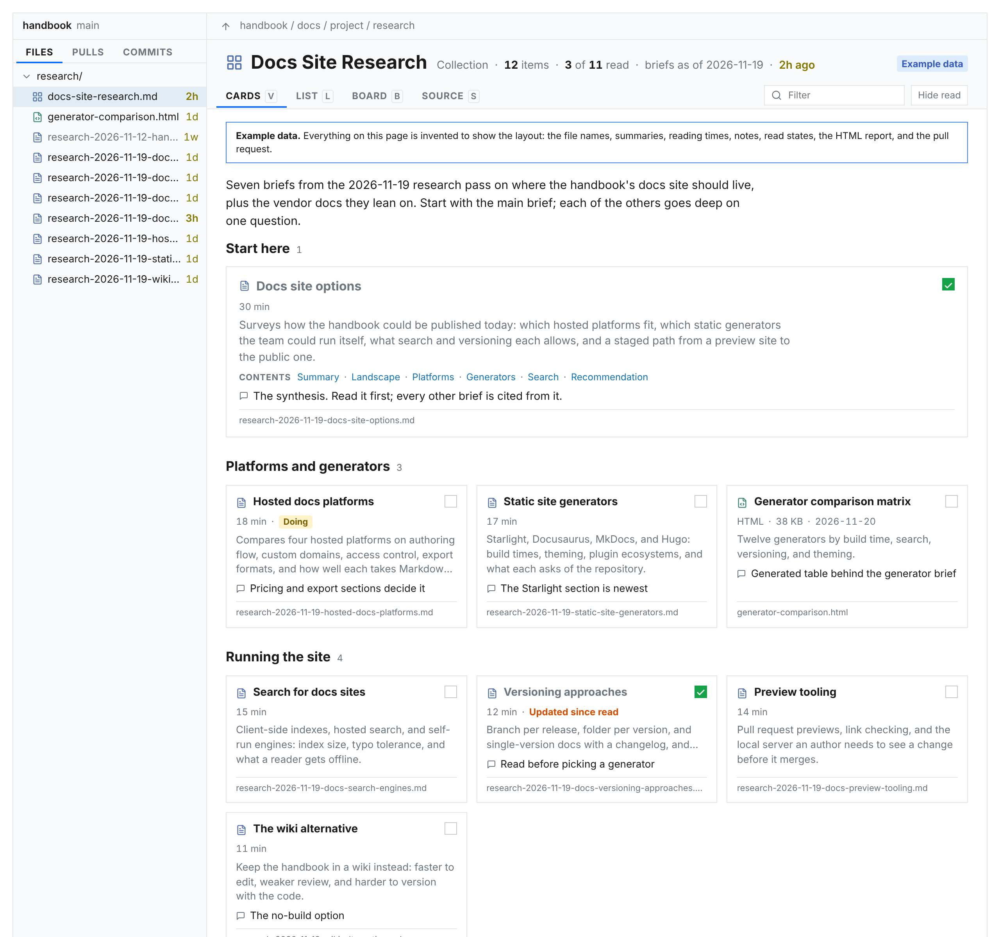

# Research: Collection Documents for Dashboards, Reading Lists, and Boards

**Date:** 2026-11-20

**Author:** Joshua Levy (github.com/jlevy) with LLM assistance

**Status:** Draft. A brainstorm that lays out options and their trade-offs.
No decision is taken here.

**Update 2026-11-23:** the owner chose a format, Collection/v1, with Guided PR as its
first use;
[Annotated Collections](research-2026-11-22-annotated-collections-and-guided-pr.md)
records it and the phases.
That brief answers choices 1, 2, 4, 12, 13, 14, and 16 for a first format, and this one
stays the map of the wider design space.

## Overview

An agent finishes a research task and leaves seven Markdown documents in a folder.
Reviewing them today means opening seven files one at a time.
What the reviewer wants is one page: a card per document with its title, date, summary,
and whether they have read it, grouped the way the author meant them to be read.

This brief asks how Metabrowser could make that page, and pages like it, almost free to
write. The same shape covers a reading list that mixes local documents and web pages, a
set of bookmarks, a review checklist for a pull request, and later a Kanban board.
Notion does this with databases and views.
The question is whether something much smaller can do it as a readable, diffable text
file that an agent writes without instructions and a plugin renders.

The brief does not choose a design.
For each choice it lists the options, what each costs, and what each reviewer leaned
toward, so the owner can decide.
It builds on the object model plans in
[pull request 570](https://github.com/jlevy/metabrowser/pull/570) and on SoftSchema.



The picture is a mockup with example data, not a decision; the
[design memo](research-2026-11-20-collection-documents-design.md) explains it.

### The Document Set

| Document | What it holds |
| --- | --- |
| This brief | The design space: every choice, its options, and their trade-offs |
| [Prior art](research-2026-11-20-collection-formats-prior-art.md) | The survey of Notion, Obsidian, Quarto, directive syntaxes, bookmark formats, and Kanban-as-text, with syntax examples |
| [Design memo](research-2026-11-20-collection-documents-design.md) | Authoring ergonomics, card anatomy, layouts, interaction, and the mockup’s screenshots |
| [Technical review](../reviews/review-2026-11-20-collection-documents-technical.md) | An adversarial review of this brief’s first draft against the plans and the code |
| [Mockup](assets/collection-documents/collection-mockup.html) | A self-contained HTML page: Cards, List, Board, and Source tabs over example data |
| [Reading list](research-2026-11-20-collection-documents-reading-list.md) | These documents as a collection document, written in one candidate syntax, to show how the raw file reads on GitHub today |

## Questions to Answer

1. What is the smallest file a person or agent can write that renders as a useful
   dashboard of other documents?
2. Which syntax carries which part: frontmatter, Markdown lists, fenced YAML blocks,
   HTML or XML tags, or pure YAML?
3. How does it meet the object model: references, shapes, collections, and views?
4. How do external URLs join local files in one list, and where does their card metadata
   come from?
5. How does a Kanban board fit the same model and stay clean YAML or Markdown?
6. How do arbitrary HTML documents fit?
7. What belongs in plugins, and what would core have to add?

## The Example

The examples in these documents use one invented case: a research pull request that
added seven briefs on where a team’s handbook site should live, all in one folder.

- `research-2026-11-19-docs-site-options.md`: the main brief
- `research-2026-11-19-hosted-docs-platforms.md`
- `research-2026-11-19-static-site-generators.md`
- `research-2026-11-19-docs-search-engines.md`
- `research-2026-11-19-docs-versioning-approaches.md`
- `research-2026-11-19-docs-preview-tooling.md`
- `research-2026-11-19-wiki-alternative.md`

Each carries an `as_of` field at the top and a Date line under its title.
Most of what a card needs is already in the files.
A dashboard should only have to say which files, in which order, under which headings,
and optionally a note per file.

## The Design Space at a Glance

Each row is a choice the format has to make.
The sections under [Choices and Options](#choices-and-options) give the detail.

| Choice | Options | Main tension |
| --- | --- | --- |
| [1. Where items live](#1-where-items-live) | Markdown link lists; YAML in frontmatter; a fenced YAML block; tags or directives; a pure YAML file; generated sections | Reading well as plain text against carrying structured fields |
| [2. What marks a file as a collection](#2-what-marks-a-file-as-a-collection) | A frontmatter key; a SoftSchema contract; a file suffix; a tag in the body; nothing | Zero ceremony against explicit activation |
| [3. Per-item detail in Markdown](#3-per-item-detail-in-markdown) | Note after the link; indented paragraph; bold; checkbox; nested `key: value`; inline attributes; none | Each convention is a small grammar to specify and parse |
| [4. View configuration](#4-view-configuration) | One token; a `views:` list with options; none | Simplicity against per-view control, and Decision 17 B |
| [5. Where card metadata comes from](#5-where-card-metadata-comes-from) | Target frontmatter; body fallbacks; the author’s overrides; a core facet; a plugin sub-object | Good cards against a read per target |
| [6. External URLs](#6-external-urls) | Link text and host only; author-written fields; a cached unfurl; metadata written into the file | Rich cards against privacy, request forgery, and file churn |
| [7. Boards](#7-boards) | Headings as lanes; a group-by field; both | Reads well on GitHub against sharing items with a table |
| [8. Done and read state](#8-done-and-read-state) | A checkbox in the file; a per-viewer mark; both | Shared, diffable state against private state that needs no write |
| [9. Writing back](#9-writing-back) | Read-only; the agent edits the file; whole-file save; structural edit routes | Interactivity against edit machinery that does not exist yet |
| [10. Embedding and queries](#10-embedding-and-queries) | A fence; a wrapping tag; a `from:` glob; implicit collections | Notion-like blocks against the untrusted path and bounded cost |
| [11. Prose and cards](#11-prose-and-cards) | Separate tabs; interleaved in one view | A simple view model against a Notion-like page |
| [12. Fit with the object model](#12-fit-with-the-object-model) | Items as references; items as nested objects; layouts as plugin arrangements; layouts as host options | Building now against building on the plans |
| [13. How SoftSchema is used](#13-how-softschema-is-used) | A frontmatter contract; a normalized record; a YAML face as an artifact; a soft convention for targets | Validation against ceremony for the author |
| [14. Plugin and core](#14-plugin-and-core) | A built-in plugin; an installed plugin; core | Keeping core small against what a plugin can reach today |
| [15. HTML documents](#15-html-documents) | HTML as an item; HTML as a hand-built dashboard; HTML as export | A native readable format against full freedom |
| [16. The name](#16-the-name) | Collection; dashboard; board; set; index | Matching the object model against matching what users call it |

## Findings: Prior Art

The [prior-art survey](research-2026-11-20-collection-formats-prior-art.md) has the
syntax and sources. Its findings in brief:

- **Five patterns recur.** Frontmatter declares the view and the body is the list
  (Quarto listings, awesome lists).
  Headings are groups and list items are entries (Obsidian Kanban).
  A fenced block has a YAML body (Obsidian’s `base` and `cardlink` blocks).
  A directive or tag carries each item (Markdoc, MDX, Notion-flavored Markdown).
  A pure YAML file holds sources, views, and items (Obsidian `.base`).
- **Items and views are separate everywhere.** Notion’s data source and views, Obsidian
  Bases’ `views:` list, GitHub Projects, and Anytype all keep what is in a list apart
  from how it is drawn.
- **Explicit lists and queries both exist.** Anytype names the split: a Collection is
  hand-curated, a Set is a live query.
  Quarto listings mix the two in one field.
- **A board is usually a grouped view.** Bases, GitHub Projects, and Notion group a view
  by a status field. Obsidian Kanban instead makes headings lanes and list items cards,
  which reads perfectly on GitHub and makes a move a one-line diff.
- **URLs have three tiers in Notion:** an inline mention, a bookmark card, and an embed,
  chosen by where the URL sits.
- **Link metadata is cached or written in.** Notion and Raindrop fetch Open Graph data
  on a server and cache it.
  Obsidian’s Auto Card Link writes it into the note, which works offline and goes stale.
- **Expression languages are where these formats get hard.** Bases’ filter strings and
  Dataview’s query language are the parts people struggle with.
- **Notion-flavored Markdown uses XML-like tags** for databases, bookmarks, embeds, and
  columns, and keeps view configuration out of the Markdown.

## Findings: What Metabrowser Has

From the plans on this branch and the code.
Object Model citations refer to its revision in
[pull request 570](https://github.com/jlevy/metabrowser/pull/570); `main`’s copy is
older. Code claims were rechecked against `main` on 2026-11-22, after the table view,
file watches, and declared plugin dependencies landed.
The [technical review](../reviews/review-2026-11-20-collection-documents-technical.md)
has the evidence for each.

**The object model’s nouns nearly fit.**

- A reference is `{type, id}` and carries no title or other field.
- A collection is an ordered list of references from one source, with a cursor and
  freshness.
- A collection item has a note, a group, and a done state, so it is more than a
  reference. The Recent plan’s `update` type, an object with a `subject` reference, is
  the precedent for that.

**Shapes are closed and host-owned.**

- The shapes are `nav-row`, `wide-row`, `card`, and `page`.
- Decision 11 rejected plugin-defined shapes: “A plugin could invent a board or a
  gallery. Nothing else could draw that shape for other types.”
- The `card` frame is not built; Recent’s phase R4 builds it.
- The list host owns windowing, keyboard, sections, and its state record.

**Declared pages are deferred.** Decision 17 B, a page a manifest declares and the host
lays out with no JavaScript, was rejected for now as “a layout language to design before
a second page exists”.
A collection document with per-view options is close to that language, written by users.

**A file has no document metadata.**

- The `file` summary has `ext`, `size`, `kind`, and similar, and no title, description,
  or date.
- No route answers a `file` object, and none describes N files without reading their
  content.

**There is no URL type.**

- No plan has a `url` or bookmark object.
- The header’s `href` is an address in the browser, and a view-state intent refuses “a
  URL with a host”.
- A bookmarks bead (mb-qhh8) is open under the macOS app’s web pane work.

**SoftSchema fits frontmatter and YAML files, not the body.**

- Its `frontmatter-md` profile validates a payload in frontmatter and treats the body as
  “reader-facing; never a source of structured values”.
- Its `pure-yaml` profile validates a whole YAML file.
- Metabrowser’s contract registry admits only `pure-yaml` with status `enforced`.
- `cache/contracts.py` validates the user-owned `config.yml` permissively outside that
  registry, which is a precedent for user-written configuration.

**The server can already parse a link list.** `diff/markdown_projection.py` builds the
KPress MarkdownIt core on the server.
Its tokens carry resolved link targets and source line maps.

**What survives rendering depends on the syntax.** A probe of the KPress MarkdownIt core
and `inert_html.harden`, run for this brief, gave:

| Syntax | Trusted render | Untrusted (inert) render |
| --- | --- | --- |
| A Markdown link list | A list with links | The same; external links gain new-tab attributes |
| A task-list checkbox | A disabled checkbox | The checkbox is dropped; the item’s text and link remain |
| A custom tag wrapped around a list, with attributes | The tag and attributes pass through, around the list | The tag is unwrapped; the list and links remain |
| A custom self-closing tag with data in attributes | Passes through | Removed entirely; the data is lost |
| A custom tag with text content | Passes through | Only the text remains; the link is lost |
| An HTML comment | Passes through | Removed |
| A fence with an unknown language | A code block with a `language-` class | A bare code block; the language is lost |
| A `:::` container with an unknown name | Literal `:::` paragraphs | The same |

Only a `mermaid` fence keeps its language on the inert path (`DIAGRAM_LANGUAGE` in
`inert_html.py`). The probe ran the Markdown core, not the whole render route, so a
build would confirm it end to end.

**Plugins can claim such a file today.**

- A `[[kind]]` with `match = {ext = ".md", frontmatter_has_key = "<key>"}` at a priority
  above `markdown` works on Git pins too.
- A Python data hook can answer the items as a route.
- The Markdown plugin exports `mountRendered` to a plugin that declares
  `requires = ["markdown"]` and calls `mb.plugins.load("markdown")`.
- A `[[table_source]]` adapter with `requires = ["table"]` gives a kind the table
  plugin’s routes and its Table view: sort, filter, search, and a record view.
- A folder `[[view]]` may set `offer = "module:function"`, a Python predicate that
  decides which folders show it; Git revisions never offer one.
- `mb.watchFile` registers a file on the page’s event stream and is told on
  `file.changed`, within `FILE_WATCH_MAX_PATHS` per page.
- A plugin cannot add a route-backed kind, an address space, or a navigation panel.
- Python data hooks, table sources, and `offer` predicates load only from installed
  packages and built-ins.

**A YAML list of records already renders as a table.** Every JSON and YAML file has a
Table tab (key `a`) beside the default Tree.
A file whose root is a list of mappings gets sort, filter, search, and a record view
with no new code; any other root says “not a list of records”.
Link values are text cells, not links.

**Nothing can write a file’s content.** The trusted local editing plan covers rename,
move, and trash, and no write route exists yet.
The editor plugin contract is a draft whose first save is whole-file replacement.

## A Model Most Options Share

Whatever the syntax, the options below assume roughly this model.
The terms are working names.

- A **collection** is an ordered list of items, optionally grouped.
- An **item** has a subject (a local file, a folder, a commit, a pull request, or an
  external URL), and optionally a title override, a note, a group, a done state, and a
  featured mark.
- A **layout** draws the items: list, cards, table, or board.
- A **face** is a syntax the collection is written in.
  Several faces can normalize to one record, which `metab --api` prints and a golden
  pins.

Two things fall out of the model whichever options win:

- **Membership and order are data.** Under Decision 18 and the parity rules they are
  computed on the server and answered by a route, not parsed in the browser.
- **A card draws from its target.** The author writes a link; the title, date, and
  summary come from the file it points to.

## Choices and Options

### 1. Where Items Live

**Option A: Markdown link lists in the body.** Headings are groups and list items with a
link are items.

```markdown
---
collection: cards
---

# Docs Site Research

Seven briefs from the 2026-11-19 research pass. Start with the main brief.

## Main brief

- [Docs site options](research-2026-11-19-docs-site-options.md)

## Platforms and generators

- [Hosted docs platforms](research-2026-11-19-hosted-docs-platforms.md)
- [Static site generators](research-2026-11-19-static-site-generators.md): the Starlight section is newest
```

**Option B: A YAML item list in frontmatter.** The frontmatter is the data and the body
is free prose.

```yaml
---
collection:
  view: cards
  items:
    - link: research-2026-11-19-docs-site-options.md
      group: Main brief
    - link: research-2026-11-19-hosted-docs-platforms.md
      group: Platforms and generators
      note: Pricing and export sections decide it
---
```

**Option C: A fenced YAML block in the body.** The same YAML as B, inside a
````collection` fence, so a document can hold several and place them among prose.

**Option D: Tags or directives.** Either a tag per item, or a tag wrapped around an
ordinary list:

```markdown
<bookmark source="https://starlight.astro.build/" />

<cards>

- [Docs site options](research-2026-11-19-docs-site-options.md)
- [Starlight documentation](https://starlight.astro.build/)

</cards>
```

**Option E: A pure YAML file.** A `.yaml` file whose root is the collection, with no
Markdown at all.

**Option F: Generated sections.** YAML is authoritative, and a tool regenerates a
Markdown list in the body between markers, as SoftSchema’s generated sections do.

| Option | For | Against |
| --- | --- | --- |
| A. Link lists | Reads as a tidy outline as plain text and on GitHub; links are clickable everywhere; one item is one line in a diff; agents write it unprompted; survives the inert path | Fields beyond title, link, and note need conventions (choice 3); extraction rules must be specified and bounded; SoftSchema does not cover the body |
| B. Frontmatter YAML | A SoftSchema `frontmatter-md` artifact as it stands; any field is easy; agents write YAML reliably | GitHub shows a nested table in a cell; links are not clickable; a long list makes the frontmatter the whole file; bounded by the frontmatter size limit |
| C. Fenced YAML | Several views in one prose document; holds queries; degrades to readable YAML on GitHub | Links are not clickable; the fence loses its language on the inert path, so it needs an allowlist change; needs a way to load the plugin when a plain Markdown file renders |
| D1. A tag per item | Compact; Notion’s API uses it; a schema could validate attributes | The item vanishes on the inert path and on GitHub; attribute quoting is where agents slip |
| D2. A tag around a list | The data stays in links, so it degrades to an ordinary list everywhere; passes through the trusted render with attributes; can mark one list among several | Still needs the body extraction of A; the hint is lost on the inert path unless the server parse supplies it; a custom tag name is a private convention |
| E. A YAML file | A SoftSchema `pure-yaml` artifact, which the registry already admits; best for generated and query-defined collections; a board move is one scalar; a list-of-mappings root already gets the structured plugin’s Table tab | Not prose; GitHub shows highlighted YAML; no clickable links; a second file beside the documents; a root that carries view settings or a `softschema:` header is a mapping, which loses the free Table, and a key predicate can claim only a mapping root |
| F. Generated sections | Conforms to SoftSchema; readable and clickable body | The author maintains YAML and a tool rewrites the file; two copies of the list can disagree |

These combine. The pairing the first draft proposed is A as the default with E (or B) as
a second face for generated collections, both normalizing to one record.
The design memo prefers A for the same reasons and treats C as the form for embedding.
The technical review would ship A alone first.

One finding from writing the
[reading list](research-2026-11-20-collection-documents-reading-list.md) in option A:
this repository’s Markdown formatter wraps a long checkbox item so the box, the link,
and the note sit on separate lines.
It still renders as one item, but “one item is one line” holds only for short items, and
a parser has to take items from the token stream, never from lines.

### 2. What Marks a File as a Collection

| Option | For | Against |
| --- | --- | --- |
| A frontmatter key with a scalar, such as `collection: cards` | One line; a flat GitHub table; `frontmatter_has_key` works today and on pins | The key name may collide with other tools; agents will guess values, so unknown values need a defined meaning |
| A frontmatter mapping, `collection: {…}` | Room for options; one envelope SoftSchema can validate | A nested GitHub table; the same key cannot also be a scalar |
| A SoftSchema contract, `softschema.contract` | Self-describing; a validator knows what it is | Three lines of ceremony; the classifier cannot match it today and would need a new core predicate |
| A file suffix, such as `.collection.md` | Visible in a listing; no frontmatter needed | `path_glob` matches only on the filesystem, so it fails on pins and in pull request views; the logical extension is still `.md` |
| A tag or comment in the body | Sits beside the list it governs | A comment is dropped on the inert path; a tag is a private convention |
| Nothing: any Markdown file with link lists offers a Cards tab | Zero ceremony; old index files gain the view | Costs a body scan per Markdown file, which must be measured; the navigation plan requires that extensions activate only from explicit syntax or configuration; views bind to a kind, so per the Tabular plan’s Decision 12 the tab is either on every Markdown file, saying when it has no list, or waits for a per-file view-availability hook |

### 3. Per-Item Detail in Markdown

This applies only if items live in Markdown (options A and D2 above).

| Convention | Meaning | For | Against |
| --- | --- | --- | --- |
| Text after the link, after a colon | A one-line note | What a person writes anyway; awesome-list convention | A title containing a colon needs a rule |
| An indented paragraph under the item | A longer note | Ordinary Markdown | A move is no longer one line |
| A bold link | Featured | Reads as emphasis raw, on GitHub, and to an agent | Emphasis used for another reason is misread |
| A task checkbox | Done, read, or reviewed | No new syntax; GitHub renders it | The box is dropped on the inert render, so the state must come from the server parse |
| A nested list of `key: value` lines | Item properties | Reaches any field, such as `status: doing` | Not YAML; collides with nested link items; one more grammar |
| Inline attributes, `{status=doing}` | Item properties | Compact; Pandoc precedent | Shows as noise on GitHub; quoting errors |
| No properties in Markdown | Properties live only in a YAML face | The Markdown face stays a plain list | A state between unchecked and checked has nowhere to go |

The design memo keeps the nested list, rarely, for a `doing` state.
The technical review would drop it and keep properties in YAML. The server probe adds
one constraint for any choice: a task item tokenizes as a checkbox, a space, then the
link, so the item rule is “an optional task marker, then a link”, not “a first-child
link”.

### 4. View Configuration

| Option | For | Against |
| --- | --- | --- |
| One token names the default layout; every layout is a tab | Nothing to learn; the frontmatter never grows; stays inside Decision 17 A | No control over fields or columns |
| A `views:` list with options per view (fields, columns, featured, group-by) | Bases- and Notion-like control; one file can define a table and a board | It is the layout language Decision 17 B deferred, moved into user files; nested YAML that nobody skims; brittle references, such as naming a heading by its text |
| No configuration at all | The simplest file | The default layout cannot be chosen by the author |

Both reviews lean to the first row.
A `views:` list could still exist in the YAML face only, where generated boards need a
group-by field.

### 5. Where Card Metadata Comes From

| Source | For | Against |
| --- | --- | --- |
| The target’s frontmatter, by convention: `title`, `description`, `date`, with aliases such as `summary` and `as_of` | Cheap and bounded, since frontmatter is a prefix; agents can be told the convention | Files without frontmatter give thin cards |
| Body fallbacks: first H1, first paragraph, word count, reading time | Good cards from any Markdown file; “18 min” answers the reviewer’s question | A body read and a parse per target, on a request path that must be bounded |
| The collection’s author: link text and note | Always available; says why the item is here | Repeats what the target knows |
| A core `document` facet on `file`, with a batch route | One reader for cards, Recent, and Quick Search | `file` has no facets and no object route; title is kind-specific, so core needs a hook per kind; a plugin cannot add a facet to a core type |
| A sub-object on the plugin’s own item rows | No core change; ships with the plugin | A second consumer has to wait for a promotion to core |

A sensible precedence, whatever the sources: the author’s words, then the target’s
frontmatter, then fallbacks.
The design memo adds two ideas that depend on none of this: a value every item shares,
such as one `as_of` date, moves to the page header, and missing metadata removes a line
instead of showing a placeholder.

The target convention could be published as a SoftSchema schema with status `soft`, a
documented convention that is never a gate, so agents writing research documents can
read which keys a card uses.

### 6. External URLs

| Option | Card shows | For | Against |
| --- | --- | --- | --- |
| The link only | Link text, host, and path | No fetch, no state, works in untrusted folders | Plain cards |
| Author-written fields | What the author adds in the note or a YAML face | Still no fetch; reproducible | The author does the work |
| A cached unfurl | Open Graph or oEmbed title, description, and site name | Notion-like cards from a bare URL | A server fetch of document-named URLs is server-side request forgery; it leaks what the reader opens; it needs size and time bounds; the cache is persisted state needing its own route and golden |
| Metadata written into the file | Whatever a tool fetched once | Works offline; reproducible; reviewable in a diff | Churns the file and goes stale; a tool writes into a user’s document |

Other points any option has to settle:

- **Whether a URL is an object type or a field.** A `url` type conflicts with `href`
  being an address in the browser and with the intent rule.
  A `web_url` field on the item avoids both, and the Object Model already has an open
  question on a header web address.
- **Opening.** The macOS app opens a web pane only for an `https` page on a known site’s
  hosts, GitHub alone today, and sends every other link to the system browser; a page
  marks links with `data-web-view`. An external mark shows before the click.
- **Images.** The design memo argues for none at all, not even favicons: they need
  fetches, make row heights uneven, and pull the page toward a link aggregator.
- **Known hosts.** A GitHub URL the localizer can prove belongs to the served repository
  could draw as a pull request or a commit with that type’s own card.
- **Rendering never fetches.** Every reviewer agrees on that rule, whatever else is
  chosen.

### 7. Boards

**Headings as lanes.** The document is the board:

```markdown
---
collection: board
---

## Todo

- [Check versioning on the hosted plans](research-2026-11-19-docs-versioning-approaches.md)
- [Read the Docusaurus versioning guide](https://docusaurus.io/docs)

## Doing

- [Draft the generator comparison table](research-2026-11-19-hosted-docs-platforms.md)

## Done

- [Main brief](research-2026-11-19-docs-site-options.md)
```

**A group-by field.** The board is a view over items that carry a status:

```yaml
collection:
  view: board
  group_by: status
  groups: [todo, doing, done]
  items:
    - link: research-2026-11-19-docs-versioning-approaches.md
      title: Check versioning on the hosted plans
      status: todo
    - link: https://docusaurus.io/docs
      title: Read the Docusaurus versioning guide
      status: todo
```

| Option | For | Against |
| --- | --- | --- |
| Headings as lanes | Reads as a board on GitHub; a move is a line move; needs no properties | The same items cannot also be grouped another way; lane order is heading order |
| A group-by field | Table, cards, and board share items; suits generated boards; a move is one scalar | Needs a properties syntax, so it fits a YAML face better than Markdown |
| Both, normalizing to one `group` value | Each face uses its natural form | Two ways to say one thing; a file that uses both needs a rule for which wins |

A third reading, from the design memo, derives lanes from state in a reading list: an
empty box is Todo, a `doing` status is Doing, and a checked box is Done.
It needs the in-between state that choice 3 leaves open.

On the object model side, lanes are parallel lists, and the list host’s sections are
consecutive. The technical review’s reading is that a board is a page view mounting one
list host per lane, which waits for view state that covers several lists.

### 8. Done and Read State

| Option | For | Against |
| --- | --- | --- |
| A checkbox in the file | Shared, diffable, visible on GitHub; an agent can set it | Changing it from the page needs a write path; it is the document’s state, not the reader’s |
| A per-viewer mark held by Metabrowser | Needs no file write; works on pins and in untrusted folders | Persisted state with its own route and golden; not shared; invisible in the file |
| Both: the box is tracked state, a dimmed dot shows what this reader has opened | Each does its own job | Two notions of “read” on one page |

The design memo adds “Updated since read”: a target modified after its box was checked.
It needs the time the box was checked, which the file does not hold; Git blame on the
line could supply it in a repository.
Keeping an open page current needs no new machinery: `mb.watchFile` on the collection
file and its targets refetches on `file.changed`, as the live table does, within the
per-page watch bound.

### 9. Writing Back

| Option | For | Against |
| --- | --- | --- |
| Read-only: the page shows the file | Buildable now; nothing to secure | No drag, no checking a box from the page |
| The agent or the person edits the file | Already works; the file is the editor | Not interactive |
| Whole-file save through the editor contract | The contract’s planned first save | The contract is a draft with nothing built; a whole-file write for a one-line change |
| Structural edit routes: check an item, move an item | Small, exact edits; each has a `metab` form | Plugin-defined mutations are a non-goal of the editing plan’s first phase; a move is several lines when an item has a note paragraph |

Any write also has to be a server operation reached by a route, so it has a `metab`
equivalent and a golden, and it runs only where `--allow-edits` permits.

### 10. Embedding and Queries

**Embedding a view in another document.**

| Option | For | Against |
| --- | --- | --- |
| A ````collection` fence | Familiar; holds YAML items or a query | Loses its language on the inert path; needs an allowlist change in `inert_html.py` and its JavaScript twin, and a way to load the plugin for a plain Markdown file |
| A tag around a list | Degrades to an ordinary list everywhere | Marks a list but cannot hold a query |
| A link to a collection document | Nothing new: the linked collection is a card that opens it | Not inline |
| Obsidian-style transclusion of a collection | Bounded transclusion already exists | Wiki syntax is parsed in the browser, not on the server |

**Queries: a collection with no list.**

```yaml
from: research-2026-11-19-*.md
sort: [title]
view: table
```

| Option | For | Against |
| --- | --- | --- |
| A `from:` glob or folder | The seven-brief dashboard is three lines; new files appear on their own | Must match the inventory, refuse `..` and absolute patterns, and share one budget across a document, or one hostile file causes many reads |
| A `where:` mapping of field-equals-value pairs | Filters without a language | The first step toward a query language; where it stops needs deciding |
| Implicit collections: a folder’s documents, a pull request’s changed files | No file to write at all; the motivating example becomes a view choice on the pull request page | Order and grouping are whatever the source gives; no notes |
| No queries | Explicit lists only | An agent must rewrite the list when files change |

The implicit option is worth separating from the format question.
The same route internals could serve a Documents view over a folder or over a pull
request’s changed Markdown files, with a different member source.
A folder `[[view]]` with an `offer` predicate shows that view only on folders that hold
documents; it is never offered on a Git revision or by an operator-directory plugin.

### 11. Prose and Cards

| Option | For | Against |
| --- | --- | --- |
| Separate tabs: Document shows the prose, Cards shows the items | Each view is simple; nothing to interleave | The author’s framing prose is a tab away from the cards |
| Interleaved: the Cards view is the rendered document, with each item list drawn as cards in place | Notion-like; prose that says “start with the main brief” sits above it; no Document tab needed | The page is a rendered document plus several mounted lists, which the list host and view state do not cover yet |

The design memo recommends interleaving for the reading layouts (Cards and List) and
dropping prose in the working layouts (Board and Table), since prose beside an item that
moved would be wrong.
One way to build it is to render the Markdown as usual and replace each item list in
place, using the server’s answer for which lists are items.

### 12. Fit with the Object Model

**What an item is.**

| Option | For | Against |
| --- | --- | --- |
| A reference plus context passed beside it | The simplest reading of “a collection is a list of references” | A note, a group, and a done state belong to the item, not the list; the same file twice breaks a store keyed by `{type, id}` |
| A nested object, `collection-item`, with a `subject` reference | Follows Recent’s `update`; a stable `id` within the parent; carries what its card needs, which avoids one `/api/file` read per target | A plugin type, which needs Python, a contract, and a corpus; its `id` must survive edits |

**What a layout is.**

| Option | For | Against |
| --- | --- | --- |
| A plugin-provided arrangement of host shapes | Plugins could add layouts; no type draws anything new | Arrangement is what Decision 11 reserves to the host: windowing, keyboard, and the list facet change with it |
| List and cards as one list host with a shape; grid as a host arrangement of the `card` frame; board as a page of list hosts; table as a table source | Uses only what the plans already have or have deferred; the table source is built | The rest waits on something: R4’s frame, view state for several lists |
| Draw privately inside one page view, as today’s plugins do | Buildable now with the current SDK | It is the drift Decision 12 names; it is rewritten when the object model lands |

**When to build.** The object model is planned, not built.
A collection plugin could ship before it with hand-drawn cards and move later, or wait
for the `card` frame and the manifest blocks.
The first is sooner and is partly thrown away; the second is cleaner and later.

### 13. How SoftSchema Is Used

| Use | For | Against |
| --- | --- | --- |
| A `frontmatter-md` contract on the collection’s frontmatter | Validates configuration; self-describing | The registry admits only `pure-yaml` and `enforced`; ceremony for the author |
| Validate the frontmatter permissively outside the registry, as `config.yml` is | No registry change; unknown keys kept | Less visible to `--doctor` |
| A contract on the normalized record the route answers | The parsed result is validated and pinned whatever face it came from; fits “validation in tests, goldens, and at trust boundaries” | The author never sees it |
| The YAML face as a `pure-yaml` artifact with a `softschema:` header | The registry admits it today; `softschema validate` works on the file | Three header lines in a file meant to be trivial |
| A `soft` schema for target documents’ card fields | Documents the convention for agents; never rejects a file | A convention nothing enforces can drift |
| Generated sections | The only form in which SoftSchema covers the body | Choice 1, option F’s costs |

One correction to the first draft: in the pinned SoftSchema, `permissive` does not
loosen validation by itself; whether extra keys are kept is a property of the model.

### 14. Plugin and Core

| Option | For | Against |
| --- | --- | --- |
| A built-in plugin | Can use Python data hooks and the bounded frontmatter loader; covered by the parity checks | Ships in the package, so it is “core” in size if not in coupling |
| An installed plugin | Truly outside core; the model for downstream formats | `metabrowser.plugin_api` exports no bounded frontmatter loader today |
| An operator-directory plugin | No install | JavaScript only, so it cannot answer membership as a route, declare a table source, or offer a folder view |
| In core | Fewest seams | Against the instruction to keep core consumer-agnostic |

What core would have to add depends on the other choices:

| If the design includes | Core needs |
| --- | --- |
| Link lists, a frontmatter key, cards drawn in the plugin | Nothing |
| An installed plugin | The bounded frontmatter loader exported |
| Fences | An inert allowlist change and a fence-to-plugin loading rule |
| A SoftSchema contract as the trigger | A classifier predicate |
| A core `document` facet | A per-kind describe hook and a `file` batch route |
| A grid of the `card` frame | The frame and an arrangement option, with Recent’s R4 |
| A board of list hosts | View state for a page of several lists |
| A table | Nothing: a built-in or installed plugin declares a `[[table_source]]` over its items |
| Checking a box or dragging a card | The editor contract’s structural edits |
| Unfurling | A fetch policy, a cache format, and its route |

### 15. HTML Documents

| Use | For | Against |
| --- | --- | --- |
| An HTML file as an item | An agent’s HTML report gets a card from its `<title>` and description and opens in the existing sandboxed preview | Reading `<title>` is one more kind-specific describe step |
| A hand-built HTML dashboard | Total freedom; already renders in the HTML plugin’s sandbox | Not readable as text, not diffable in a useful way, no shared look, nothing for `metab` to report; each one is built from scratch |
| HTML as export: `metab` renders a collection to one static page | Shareable outside Metabrowser | A second renderer to keep in step with the first |

A native format and HTML are complementary.
The native format covers the common case with a shared look; HTML stays the escape
hatch, and a collection can list HTML reports beside Markdown ones.

### 16. The Name

| Name | For | Against |
| --- | --- | --- |
| Collection | The object model’s word for an ordered list; promises nothing extra | Generic as a frontmatter key; Jekyll and others use the word |
| Dashboard | What the owner asked for | Suggests metrics and charts |
| Board | Short | Means Kanban only |
| Set | Short | Anytype’s word for a live query, the opposite of a hand-curated list |
| Index | Familiar for a page of links | Collides with search |

## Three Ways the Choices Could Combine

These are sketches to make the trade-offs concrete, not proposals to pick between.
They also read as a sequence.

**A. The link list alone.**

- Markdown face only, a one-token frontmatter key, List by default and Cards once
  Recent’s R4 builds the `card` frame, plus a Table through a table source.
- Card fields from target frontmatter; URLs draw from link text and host.
- Read-only: checkboxes come from the file.
- One built-in plugin, one route, no core change.
- It delivers the seven-brief dashboard and a mixed reading list.
- It leaves out boards, embedding, queries, and any write.
- This is the technical review’s first step.

**B. Two faces and implicit collections.**

- Adds a YAML face as a SoftSchema artifact for generated collections and boards.
- Adds a Documents view over a folder and over a pull request’s changed files.
- Adds a read-only board.
- It needs view state for several lists.

**C. Notion-like blocks.**

- Adds embedded views in any document, queries, checking and dragging from the page, and
  unfurled URL cards.
- It needs the inert allowlist change, fence loading, the editor contract’s structural
  edits, and a fetch policy with a cache.
- It is the furthest from “a text file with a view”, and the design memo argues against
  its images and its per-view field lists on simplicity grounds.

## What Each Option Needs for Parity

[Agent Instructions](../../../AGENTS.md) require a `metab` equivalent and a golden for
every route, kind, and persisted state.
Whatever is chosen:

- The kind needs a `kind:` line in a successful `metab --show` golden.
- Each data hook needs a route-table row and an `--api` golden: groups, a checkbox, a
  reference-style link, a URL item, a missing target, an escape attempt, and an
  over-budget file.
- Each layout’s `describe` and its group and keyboard state need a browserless session.
- Paint may be exempt only with a named reason and focused evidence.
- A write, a read mark, and an unfurl cache are each persisted state, so each is a route
  with its own golden.
- The [map](../architecture/arch-views-models-routes.md) and a changelog fragment land
  in the same change.

New size limits are measured before they are set, and recorded beside their constants.
The link-label scan is MarkdownIt’s slow case, and a link list is that shape, so the
parser’s bounds need their own measurement.

## Open Questions

For the owner:

1. Is the first goal the curated file, or the no-file view over a folder or a pull
   request’s documents?
   They share most of the machinery and differ in what gets built first.
2. Should it ship before the object model, with cards drawn in the plugin and rewritten
   later, or wait for the `card` frame?
3. How much should the Markdown face carry before fields move to a YAML face: notes
   only, or properties too?
4. Is a board wanted soon enough to shape the first format, given that drag needs edit
   machinery that is not built?
5. Is done state the document’s (a checkbox) or the reader’s (a mark), or both?
6. Should URL cards ever fetch, and if so, on whose instruction?
7. Is “collection” the name users see?

For the design, whichever way those go:

1. What is an item’s stable `id` across edits?
2. Which frontmatter key, and what does an unknown value mean?
3. Can a custom wrapping tag be relied on across KPress versions, and what does GitHub
   do with it? The probe covers Metabrowser’s side only.
4. How does a host frame activate an external address?
5. How does the store get N `file` summaries by reference outside the tree, and does
   Recent need the same?
6. Should the document-metadata reader be shared with the navigation plan’s frontmatter
   alias lookup from the start?
7. Does a fence in an untrusted document get to invoke a plugin renderer at all?

## References

- [Prior art for plain-text collections and dashboards](research-2026-11-20-collection-formats-prior-art.md):
  the survey, with every external source
- [Design memo](research-2026-11-20-collection-documents-design.md): ergonomics, card
  anatomy, layouts, interaction, and the mockup
- [Technical review](../reviews/review-2026-11-20-collection-documents-technical.md):
  the evidence behind the constraints above
- [Object Data Model and Views](../specs/active/plan-2026-11-14-object-data-model-and-views.md):
  references, collections, shapes, and Decisions 11, 12, 17, and 18
- [Plugin Authoring](../specs/active/plan-2026-11-18-plugin-authoring-objects-views.md):
  manifest blocks and the list host’s options
- [View Model and View State](../specs/active/plan-2026-11-18-view-model-and-view-state.md):
  the list facet and the limits on intents
- [The Recent Tab](../specs/active/plan-2026-11-18-recent-tab-updates-and-events.md):
  the `update` type and the `card` frame’s first use
- [Tabular Data and Live SQLite](../specs/active/plan-2026-11-19-tabular-data-and-live-sqlite.md):
  the table source, now built
- [Markdown Navigation Extensions](../specs/active/plan-2026-08-13-markdown-navigation-extensions.md):
  explicit activation, bounded transclusion, and frontmatter alias lookup
- [Trusted Local File Editing](../specs/active/plan-2026-07-16-trusted-local-file-editing.md)
  and the
  [editor plugin contract](../specs/active/plan-2026-07-17-editor-plugin-editing-contract.md):
  what can and cannot be written
- [Plugin Authoring guide](../../plugins.md) and
  [Plugin System](../architecture/arch-plugin-system.md)

<!-- This document follows common-doc-guidelines.md.
See github.com/jlevy/practical-prose and review guidelines before editing.
-->
