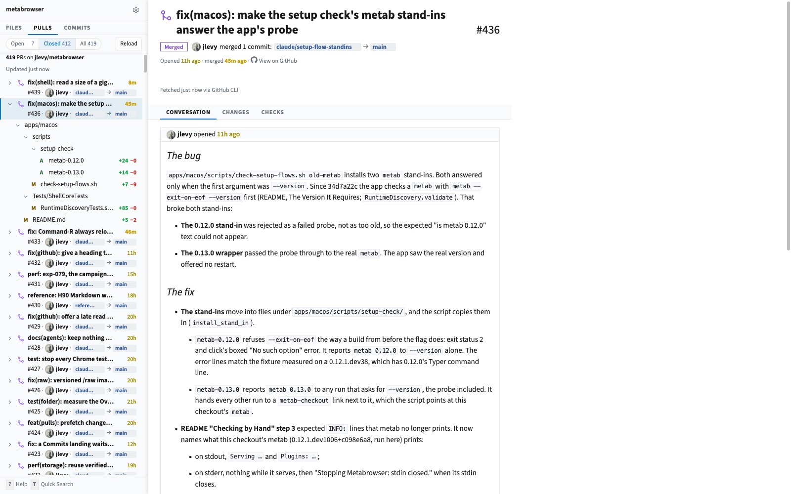

# Reviewing Pull Requests

Metabrowser reads GitHub pull requests from a repository URL, a pull-request URL, or a
checkout you already have.
The Pulls tab lists the repository’s pull requests, and each pull request’s page shows
its description, conversation, reviews, checks, and changes.
What it fetches is cached, so a pull request you have read stays readable offline.



Cloning needs Git, and reading pull requests from GitHub needs GitHub CLI (`gh`), signed
in; [installation](installation.md#git-and-github-setup) says how to set them up.
Cached pull requests stay readable without `gh`.

## Open a Repository or a Pull Request

```shell
metab https://github.com/owner/repo           # a repository
metab https://github.com/owner/repo/pull/123  # one pull request
metab ~/src/repo                              # a checkout, a linked worktree, or a folder in one
```

- **A repository or pull-request URL** clones the repository into your cache once and
  serves it pinned to one commit: a pull-request URL pins the pull request’s head.
  Later runs reuse the clone.
- **A local path** serves that folder as it is on disk, local changes included.
  It shows **Pulls** when its checkout’s `origin` is on github.com and its `HEAD` can be
  read. On a fork, the list belongs to `origin`, usually the fork, and the tab names the
  repository.

`metab` prints the address it serves and opens your browser there; Ctrl-C in that
terminal stops it. A first clone reports its progress on stderr:

```text
cloning https://github.com/pallets/click into ~/.cache/metabrowser
cloned https://github.com/pallets/click in 4.9 s (5.3 MiB); starting the server
Serving https://github.com/pallets/click at http://127.0.0.1:8411/pull/3866
```

A GitHub URL ending in `/pull/123/changes` (or the older `/pull/123/files`) or
`/pull/123/checks` opens that tab, and one ending in `/pull/123/commits` opens the
conversation, where the commits appear.
A Changes tab link to one file, ending in `#diff-` and a long hash, opens that file, or
the Changes tab when the pull request’s changed files are not cached yet
([pull requests](command-line.md#pull-requests) has the details).
If you already have the repository checked out, `--checkout` lets the clone borrow its
objects instead of copying them; see
[beside a checkout](command-line.md#beside-a-checkout).

## The Pulls Tab

Choose **Pulls** beside Files and Commits, or press `P`. The list starts on **Open**;
**Closed** includes merged pull requests, and **All** shows both.
Each filter shows its total when the catalog knows it.
When you open a pull request the list does not show, by a link, Quick Search, Back, or a
stack key, the list moves to **All**, or to the pull request’s own filter when it is too
far down All, and selects it there.
A filter you choose stays as you chose it.

Rows are newest first, each with its open, draft, merged, or closed state.
Metabrowser fetches the repository’s list of pull requests in the background and shows
each page as it arrives; scroll toward the end to load more, and a spinner below the
last row says how many have been fetched so far.

Each row reads as one run: the title, the number, and the author, such as **Fix the
reader · #455 · jlevy**, wrapping as far as it needs, each line starting under the
title. The lines the pull request adds and deletes are on the line below, with a chevron
after them, such as **+1,234 −567 ›**, so walking the list shows the size of each
change, and the age, such as **3d**, is at that line’s right end, where every row’s age
lines up. At the Pulls tab’s default width most rows take four lines, and a short title
three; a wider tab fits more rows in three.
The lines sum the same list of changed files the row’s tree shows, as a stack’s heading
sums its pull requests’, and ask GitHub for nothing: the lists come from what the Pulls
tab already reads behind you for the rows in view and from trees you open, and a gray
placeholder holds their place until one arrives.

Click a row anywhere to open its pull request; its files stay as they were.
The lines and the chevron after them show and hide the files, which start collapsed:
click either to show or hide them under the row.
No row expands on its own.
Click a file to open **Changes** at that file.
Move between pull requests with `J` and `K` or the arrow keys; each pull request is one
row. Enter opens the focused pull request, and Space shows or hides its files.
Right shows them, or moves into them once shown, and Left hides them.
The file list says **Listing changed files…** until GitHub answers.
Once the files show, a later page or an updated list does not move the rows you are
reading: it is offered as **Show N more files** or **Show the updated list of N files**.

To start over, click the folder’s name at the top of the navigation pane, or press `0`.
That is Home: the folder as a fresh load shows it, with every tab at its first, so
**Pulls** opens its list and a pull request you open from it opens on **Conversation**,
whichever tab you last read.

### Stacks

With the optional [gh-stack extension](installation.md#git-and-github-setup), the Pulls
tab groups the pull requests of each native GitHub stack under a **Stack #N** row, open
by default, top of the stack first; pull requests in no stack follow, and a stack’s row
opens and closes like a folder.
The row shows how many pull requests the stack has and how long ago one of them last
changed, such as **Stack #286 · 4 pulls** and **2h**. Under it, beside the stack’s pull
requests, **Stack Overview** shows the lines the whole stack changes; press that line or
the chevron after it to list every file the stack changes, as the stack’s page does, and
press anywhere else on the row to open that page.
A member’s row shows its place after its title and before its number, such as **Fix the
reader · 1/6 · #455 · jlevy**; a pull request in no stack shows no place.
A pull request in two stacks sits under the first, and its place names the other stack
by its number, such as **3/4 · ⧉300 2/2**.

On the page, a stack button at the end of the line of state and dates shows the same
position, and a pull request in two stacks has a button for each, which names its stack,
such as **⧉300 2/2**. The button opens a menu of the stack’s members, from top to base,
each on one line: its state and its title, then its position, its number, and its author
at the line’s end, such as **Fix the reader 1/6 · #455 · jlevy**, the order a row in the
Pulls tab has. On macOS, Control-N goes to the next member toward the top and Control-P
to the previous one toward the base; on Windows and Linux, where those keys are the
browser’s, use the menu.
Without the extension, or when GitHub cannot answer, pull requests read as usual and the
list stays flat, unless stacks are cached.

**Stack Overview**, the first row in the menu and under each open stack in the Pulls
tab, opens the stack’s own page, laid out as a pull request’s page for the whole stack,
each line saying of all its pull requests what a pull request’s says of one: how many
are in each state, such as **2 Pulls Open**, and when one was last opened and last
updated; their authors and commits; the top member’s head branch → the stack’s base;
their labels; the commits, files, and size of the stack’s combined change; the pull
requests themselves under **N Pulls**, top first, each as the menu lists it, closed at
first as the Diff summary is; then the Diff summary of that change, and **Docs** and
**Changes** of it, with **Guided Review** first when the stack has a guide.
**View on GitHub** there opens the stack on github.com.
While that page is open, the stack’s **Stack Overview** row in the Pulls tab is marked
as the current row, as a pull request’s row is on its page; J and K stop on it and open
the page, as they open a pull request’s. Metabrowser reads stacks and never changes
them.

## The Pull Request Page

The header gives the title and number; the state and dates, with any stack button at the
end of their line; the author’s sentence, such as “octo wants to merge 2 commits”; the
head and base branches on a line of their own, head → base; and the labels, each in the
color GitHub gives it, with its description, if any, shown on hover.
The author’s GitHub avatar is beside the name, and a neutral person icon holds its place
where GitHub gave none, as on a commit’s page; a Pulls row shows none.
**View on GitHub**, in the page’s upper right as on a file’s, a folder’s, and a commit’s
page, opens the tab’s own page on github.com, and its menu copies that link or opens it
in the browser. Its last row is the **Diff summary**, on every tab, collapsed: the files
and lines changed, such as “35 files changed · 2 A, 3 D, 30 M · +1,234 −3,423”, which
opens into the tree of changed files with rolled-up line counts, and a file there opens
**Changes** at that file.
While the comparison it counts is on its way, as when Conversation prepares it in the
background, the row holds a gray pulsing block after a moment; that block is the only
sign of the background work.
A cached page shows at once and refreshes in the background; the
[design system](design-system.md#the-pull-request-page) describes how it draws.

### Tabs

The page has up to five tabs:

- **Guided Review** (`R`), the first tab when the description includes a guide: the
  description as the guide’s overview, then ordered review steps with commentary above
  selected diff excerpts.
  The tab appears when the description has a line that opens a `guided-review` fence;
  the server’s reading of the block decides what the tab then shows.
  A pull request with a guide opens on it at `/pull/<n>`, and Conversation moves to
  `/pull/<n>/conversation`; without one, `/pull/<n>` is Conversation.
- **Conversation** (`C`): the description, then comments, reviews, and commits in
  GitHub’s order, joined by a timeline line.
  Where the description has its guide, Conversation shows a card that opens Guided
  Review. Commits that arrive while you read are added after what is shown.
  A short commit ID opens that commit on GitHub.
  **Review comments** lists the inline review comments with their files and diff hunks.
- **Docs** (`D`): the changed documents alone (the File type menu’s Documentation group:
  Markdown, plain text, reStructuredText, and the rest).
  Docs opens the new version in **Full**, rendered where available.
  A large document opens as an excerpt with a notice and a way to read the full file.
  Docs draws source diffs in Unified.
  The tab shows only when the pull request changes a document: it appears at once and
  goes when the comparison’s File type counts say no document changed.
  An address on Docs still opens it, and says so, with a link to Changes.
- **Changes** (`G`): the diff from the merge base to the head, **Split** or **Unified**
  (`L` switches). Markdown files open as rendered changes, as the next section describes.
  It opens on **Diff**. The [comparison toolbar](#comparison-view) also offers
  **Excerpt** and **Full**. The changed-file list on the Pulls tab moves through this
  diff, and the selected file follows the diff as you scroll.
  The **File type** menu ahead of the comparison and layout choosers (`Y`) shows only
  the changed files of the types you choose, as a commit’s does
  ([A Commit’s Page](browsing-history.md#a-commits-page)); the page keeps the choice
  while you visit the other tabs, and a file you jump to that it hides shows every type
  again.
- **Checks** (`E`): the check runs and commit statuses, with links to their details.

### Links in a Pull Request’s Text

A link in the description, a comment, a review, or a Guided Review note goes where
GitHub sends it, except where Metabrowser can show the same thing itself: a link to this
repository’s pull request, its Changes or Checks, a commit, or the list of pull requests
opens that page here, and so does one to a file on the branch or commit being browsed,
as in a Markdown file ([links](browsing-files.md#markdown)). A path such as
`docs/plan.md`, which GitHub resolves under the pull request’s own page where nothing
is, opens that file at the pull request’s head instead: in place when the head is what
Metabrowser serves, in Changes at that file when the pull request changes it, and on
GitHub otherwise. A stack’s notes do the same with the stack’s Changes.
A link to another branch, a tag, an issue, or a particular comment stays a GitHub link.
In Changes and Docs, a rendered document’s link to another file of the head opens it
here while the head is served, and on GitHub otherwise.

### Guided Review

The guide opens on its overview, the description, under a list of its steps.
The overview is step 0 and the author’s steps follow it in their review order.
Choose a step in the list to go straight to it, or use the arrows in the list’s head to
page through them; below each step, the way on names the next step and the way back the
one before. A step can bring changes from several files together, each drawn as Changes
draws it. **Open full diff** goes to the file in Changes.
A guide may gather its steps in groups, such as Decisions, Changes, and Testing: the
list names each group above its steps, which keep their numbers through the groups, a
step’s card names its group before its place, as “Decisions · Step 2 of 12”, and a
group’s note shows above its first step.

To publish a guide, have the author or their agent add one top-level `guided-review`
fenced YAML block to the GitHub PR description.
Give the agent the PR description and the diff from its merge base to its head.
Ask it to choose the code to review in dependency or execution order.
Each step should explain why the reviewer is looking there and what to verify.
Keep a guide short: one step for each area of the change and one for each concern that
has something to say, such as the key decisions, open questions, and testing, each note
one to three sentences and citing what a reviewer must read rather than every changed
file, which Changes already lists.
A group gathers two steps or more; a concern of one step stays a step of its own.
The [agent skill](../skills/metabrowser/SKILL.md) has the full recipe.

The description is the guide’s overview.
Guided Review opens with it, rendered as Conversation renders it and without the block,
so write it to be read first: a few lines on what is true once the change lands, then
why, then how its parts fit together.
The block itself has no prose of its own.

The block is a collection (`metabrowser.collection:Collection/v1`), a general format for
ordered annotated items that guided reviews are the first use of
([Collection Format](project/architecture/arch-collection-format.md)). In a guided
review it holds the comparison it was written against and ordered `items`, each a step
with a `title`, a `note` saying what to verify, and its `references`, or a group of
steps with a `title`, an optional `note`, and its own `items`. A title is plain text,
shown as typed. A note is Markdown, rendered as the description is, inert, in every
guide: raw HTML is cut to the same safe subset, a single line break joins two lines into
one paragraph, and a blank line starts the next.
A Mermaid block in a note shows as code.
Write a link to a file in a note as its path from the repository’s root, such as
`docs/plan.md`: it opens that file at the pull request’s head, here when Metabrowser can
show it and on GitHub otherwise.
GitHub shows the guide’s block as code, so such a link costs nothing there; in the
description, which GitHub renders, a path like this leads nowhere on GitHub, so write a
full link there if its readers matter.
A full GitHub link into the repository opens its page in Metabrowser when there is one
([Links in a Pull Request’s Text](#links-in-a-pull-requests-text)). A note whose render
takes too long, or fails, shows as typed, with its line breaks kept and the line a
description’s refusal says under it; when the renderer was only busy, returning to the
step or reloading the page renders it.

````markdown
```guided-review
softschema:
  contract: metabrowser.collection:Collection/v1
  envelope: collection
  status: enforced
collection:
  comparison:
    merge_base: "<full merge-base commit ID>"
    head: "<full PR head commit ID>"
  items:
    - title: Inspect the request path
      note: Does the request return the snapshot before the worker finishes?
      references:
        - {path: src/cache.py, side: new, start_line: 42, end_line: 51}
```
````

Groups are optional, and a guide without them reads as it always has.
A longer guide may gather its steps in groups, as
[Collection Format](project/architecture/arch-collection-format.md#the-record) shows: a
group holds steps only, so groups do not nest, and a group without steps is refused, as
a guide without steps is.
Steps outside a group may sit between groups, and every step is numbered in reading
order, through the groups.
A group’s note is for orientation, so the page shows it once, above the group’s first
step.

Use the changed path shown in Changes, the `old` or `new` side, and an inclusive line
range within one diff hunk.
An excerpt shows a replacement whole: a line that exists only on the other side, a
deleted line for a `new` range or an added line for an `old` range, is shown when it
lies inside the range or touches either end of it, so a changed line appears with what
it replaced. A step’s excerpts share one size budget (`MAX_EXCERPT_BYTES` in
`guided_review.py`); an excerpt past it says it is too large to show.
A reference that names a whole file starts as Changes draws it.
A whole Markdown document starts as Docs draws it.
Eligible files offer **Rendered** and **Source**. Use the comparison chooser above the
step’s file cards to switch their presentation.
Full is available when the block has a whole-file citation it can read.
An excerpt stays within its cited range, and a citation of old lines keeps those lines
visible. A step’s other whole files share that budget (`MAX_STEP_PATCH_BYTES` in
`guided_review.py`); a file past it says its diff is too large to show in the step, and
**Open full diff** shows it in Changes.
A binary change or a rename without a text diff says it has no text changes to show.

A step can also cite past its pull request, so a layer’s guide can point at its
neighbors:

```yaml
references:
  - {pull: 805}                      # another pull request
  - {pull: 805, path: docs/plan.md}  # a file as that pull request changes it
  - {commit: "<full commit ID>"}     # a commit
```

A pull request shows as a row the way the stack menu lists a member: its state, its
title, its place in a stack when it has one, its number, and its author; it opens that
pull request.
The place is bare in the guide’s own stack and names any other stack, “⧉300
2/2”, and hovering it names the stack in words.
A file of another pull request is drawn as a file of this one is, from that pull
request’s own changes, under a bar that names the pull request, and its **Open full
diff** opens the file there.
It takes no line range, since that pull request may move after the guide is written.
A commit shows as a row of its short ID, its subject, and when it was made, and opens
the commit.
These are read from what this copy already has: a pull request not loaded yet
shows by its number, a file of one not loaded yet says to open it, and a commit the copy
lacks says it is unavailable.
A commit fetched with a pull request but missing from the checkout you are browsing
shows without a link, since its page reads that checkout.
None of them makes the guide out of date, except a file this pull request itself
changes, cited with its own number, which counts as a file of the guide.

The
[compiled SoftSchema](../src/metabrowser/builtin_plugins/github/collection-v1.schema.yaml)
describes the payload, and `MAX_ITEMS` and `MAX_REFERENCES` in `guided_review.py` bound
its steps and groups together, and each step’s references.

The guide is read from the cached description, and its excerpts come from the pull
request’s current comparison, so a guide stays readable after new commits.
When the pull request’s head or merge base has moved past the guide’s pins, the guide is
out of date: one warning at the top of Guided Review says so and that its author can
update the guide, and each step that cites a file whose content changed since is marked
changed, in the step list and on the step.
A reference whose file changed says so above its excerpt, or in its place when its range
no longer resolves. When the local copy lacks the guide’s head, as after a force push,
what changed is unknown: no step is marked, the warning says some steps may not match,
and each excerpt says its file may have changed.
When the guide cites no file whose content changed, as after merging the base branch in
or a rebase that leaves them alone, a quiet line says so instead of the warning.
When GitHub reports a newer head than the cached copy has, the page’s header says new
commits were pushed, and, when this copy matches the guide, the guide adds nothing until
the pull request is fetched again.
The route’s answer, below, keeps the details: the guide’s pins and the current ones, the
commits since, and the paths and steps that changed.
It also gives the guide’s `outline`, its groups and steps in reading order, and the
`group` each step is in.
To bring the guide current, update its pins and ranges in the PR description.

A guide the page cannot read says why in place of the steps: invalid YAML, a second
block, another contract, a field that fails the schema (with its place below
`collection`, such as `items.0.references.0`), more steps and groups than `MAX_ITEMS`
allows, or pins whose `merge_base` is not an ancestor of their `head`. Its block then
stays in the description, so its author sees what they wrote.
The same answer is the `guided-review` route’s, which this prints from the cached pull
request:

```shell
metab <pull request URL> --api '/api/plugin/github/guided-review?number=<n>'
```

There is no check for a guide before the description carries it, and a block inside
another fence, as in the example above, is not a guide even where the tab appears.

#### A Stack’s Guide

A native stack can have a guide of its own: one guided review of the whole stack, read
against the stack’s comparison, from its bottom layer’s merge base to its top layer’s
head.
The stack’s page, which **Stack Overview** in the stack menu opens, then leads with
a **Guided Review** tab and opens on it; without a guide it opens on Changes.

To publish one, add one top-level `stack-review` block, in the format above, to a
layer’s description, usually the top layer’s, beside that layer’s own `guided-review`
block. Pin its `merge_base` to the stack’s base and its `head` to the top layer’s head.
A description may hold one block of each kind; two of either is refused.
The stack’s guide is the block of the top-most layer that has one, so a layer added
above it leaves the guide in place, and out of date until its author moves the pins.
Editing a description starts no CI run and leaves the layer’s own guide current.

The description that carries the block introduces its layer, not the stack, so a stack’s
guide opens on its first step, and its first steps orient the reader.
On that layer’s page, Conversation leaves the block out and shows a card that says it
has a stack guide and opens the page of each stack the layer belongs to.
A step’s files open in the stack’s Changes, and a step can cite each layer as
`{pull: <n>}`. The guide is read at the comparison the page shows, as the Diff summary,
Docs, and Changes are.
While a layer is being fetched, or the stack cannot be shown as one comparison, the
guide on screen stays, and a step you have not read yet says why in its place.
When the stack moves, as when its layers’ records arrive one by one on a page just
opened, the page shows the new comparison at once until you scroll, click, press a key,
or open a tab or a file; after that it shows one that would look different only when you
ask: the status line says what changed, such as “#845 has 2 new commits and #843 was
merged.”, with **Show the new comparison**, and while a layer it waits on is fetched it
says so instead. A new comparison with the same two commits and the same files changes
nothing on the page.
The guide is read again at the comparison shown, out of date where a layer moved past
its pins. Until you take it, a step written for the new comparison, as one is once the
guide’s layer moved and its author pinned it again, says the stack has moved, and the
guide’s steps stay. The same answer is the `guided-review` route’s, by stack, at the
current comparison or at one the stack’s page named, by the `left`, `right`, and `key`
of its `comparison`:

```shell
metab <pull request URL> --api '/api/plugin/github/guided-review?stack=<n>'
```

The [agent skill](../skills/metabrowser/SKILL.md) has the recipe for writing one, with
what each step says.

### Code Controls

| Opened with | Code controls |
| --- | --- |
| A repository or pull-request URL | **Browse code** opens the pinned code, first switching the pin to this pull request’s head when another commit is served. Code served on the pull request’s head follows it: when new commits are pushed, the page moves to the new head by itself, as a page on a branch does. |
| A checkout or a folder in one | Files and Commits keep showing your checkout, which may differ from the pull request, so there is no **Browse code**. When the checkout’s `HEAD` is the pull request’s head, the page says so and offers **Browse the checkout**. |

In **Changes** and **Docs**, a changed file offers **View on branch**, after its name
and line counts, which opens the file at the pull request’s head in the main view, with
the file tree, tabs, and ref selector around it, as **Browse code** opens the whole
tree. Where it opens follows the table above:

- Opened with a repository or pull-request URL, it first switches the pin to the head
  when another commit is served, as Browse code does.
  The pin is the server’s, so every tab moves with it, and a tab whose pin another tab
  switched turns its links into the switch back.
- Beside a checkout, or a folder in one, it opens your working-tree copy of the file,
  only while the checkout’s `HEAD` is the pull request’s head and only for a file inside
  the served folder. That copy includes any changes you have not committed.

A deleted file, a symbolic link, and a submodule have no View on branch, and no file
does while Changes shows an earlier head than the pull request’s, which no branch holds
any more. If the pull request moves on in the moment before the page has followed it,
View on branch and Browse code switch nothing and say that the head has moved.

### Lines Between Hunks

A code file’s diff in **Changes** and **Docs**, and on a commit’s page, shows each
change with a few unchanged lines around it.
Each hunk’s `@@` bar opens to the unchanged lines above it, back to the hunk before or
the file’s start, and the bar after the last hunk, **Rest of the file**, to the lines
after it. The bar says how many lines it holds, and opens a long run a part at a time,
the part nearest the hunk first, with a bar for the rest.
Opening a bar above the line you are reading leaves that line where it is on the screen.
The lines are read from the pull request’s or the commit’s files when you open the bar,
and stay open as you switch between **Split**, **Unified**, and **Excerpt**. Where they
cannot be read, as for a binary file or one Git converts for its diff, the file’s hunk
bars stay plain, and the file says so.
A guided review step draws a code file’s hunks with plain bars, as a patch file does.

### Comparison View

The comparison toolbar has three choices for the whole comparison.

- **Diff** shows additions and removals with surrounding context.
- **Excerpt** shows the new version around the changes.
  A source excerpt marks removals without showing the removed text.
- **Full** shows the complete new version at the reviewed revision.
  Files too large to show whole can fall back to their excerpt.
  A standalone patch offers Diff and Excerpt.

Use **Rendered** or **Source** in an individual file’s collapsible header.
It stays selected as you switch the comparison view.
Press `N` to switch between Diff and Excerpt.
Changes and commits open in Diff and remember their choice separately from Docs, which
opens in Full.

In Source, Diff can use Split or Unified.
**Default diff layout** in the Metabrowser menu sets the layout for new comparisons.
The visible layout chooser switches it for this comparison.
In Excerpt and Full it stays visible and unavailable, and returning to Diff restores
your choice.

### Rendered Markdown in Changes

**Diff**, where Changes opens a Markdown file, shows each changed block as removed and
added, with the changed words marked, and a few unchanged blocks on each side of it.
A longer run of unchanged blocks between two changes folds behind the diff’s fold bar,
the bar a code file’s long run of changed lines folds behind, which opens the run in
place. A long run’s blocks are fetched when you open it, or follow a link to a heading
inside it. **Expand unchanged sections** opens the whole rendered comparison with
removals visible. **Full** shows the entire new document, and **Source** shows the text
in whichever comparison mode you selected.

A very long file, longer than any the Docs tab opens in Full, is drawn as you scroll
near it, so the page keeps its place in the scroll bar without drawing all of it at
once. In such a file, find in page finds text only in what is drawn, and Select All
selects only that; scroll to a part, or follow a link to it, to draw it.
Printing draws the whole file first.

The rendered views show what a change does to the document as it reads, so a change that
does not show in the document appears only in **Source**: a link or image destination or
title, an image’s alt text, an HTML comment, attribute syntax such as `{#name}`, a code
fence’s language, or only whitespace and line wrapping.
A block whose destination, title, alt text, comment, attribute, or fence language
changed is never folded away.

Raw HTML, such as `<br>`, `<details>`, or a centered `<p align="center">`, renders as
the Document view renders it, through the same sanitizer; an HTML edit it does not show,
such as a class, a style, a second copy of an attribute, or words in a checkbox’s
`checked`, is a change that only **Source** shows.
A `<details>` in a changed block shows open, so the words marked inside it show; the
Document view shows it closed.
A task list draws its boxes, each ticked as the document ticks it, so ticking or
unticking one is a change that the rendered views show; so does a checkbox written in
raw HTML, such as one in a table cell.

A footnote’s reference shows its number where it is written, numbered as the Document
view numbers it, and its note shows where its definition is written rather than at the
end; an inline note shows after the paragraph that holds it.

A file with bytes that are not UTF-8, a NUL, or lines that end at a carriage return
alone renders as the Document view renders it, a byte it cannot read as `�`. Files too
large for the rendered views open in **Source**.

The rendered views also show math and Mermaid diagrams as their source text, and do not
highlight code blocks.
So a footnote reference written inside math, which the Document view renders as math, is
a footnote in the rendered views, and the notes after it can number differently from the
Document view’s.

A Markdown file’s front matter shows as the Frontmatter disclosure the file’s Document
view shows above it.
It stays closed when the front matter did not change, and opens with each changed key’s
old value removed and new value added when it did.
Front matter that does not load, or is too large for the rendered view, shows no
disclosure, and its change appears only in **Source**; the rest of the file still
renders. So does a value whose type changed and whose text did not, such as `false` that
became `"False"`.

### Rendered YAML and JSON in Changes

A changed `.yaml`, `.yml`, or `.json` file opens in **Rendered** as the tree its file
view draws.
An added or removed key or item is marked in the change gutter, and a changed
value shows its old row removed and its new row added.
Every mapping and list that holds a change is open, as far as the first screen’s row
budget allows; an unchanged one is closed with the file view’s preview of it, and a
click opens it. A long mapping or list draws its entries a page at a time, and its last
row, `… N more`, draws the next page and counts the changes the rest holds.
A changed value wraps, so a long string shows where it changed.
An alias (`*name`) and a merge key (`<<`) read as the values they name.

The tree shows what the data says, so a change to a comment, quoting, indentation, or
the order of a mapping’s keys appears only in **Source**, and a file whose only change
is of that kind says so above its tree.
The tree reads YAML 1.2, where `no`, `off`, and `y` are strings, so a change between
`no` and `"no"`, which a YAML 1.1 reader takes as `false` and a string, shows only in
**Source** too. A value whose type changed and whose text did not, such as a date that
became the string that spells it, or the key `1` that became `"1"`, is drawn unchanged,
and the tree says above it that **Source** shows a change it draws as unchanged.
JSON with a key twice in one object shows the key once, with its last value, as the file
view’s tree does, and a change to a value the repeated key hides, or the same value
hidden in another object, is one **Source** shows.
An added or deleted file that hides a value says above its tree that **Source** shows
it.

These files open in **Source**:

- YAML or JSON that does not parse
- YAML with a key twice in one mapping
- files too large, or too deeply nested, for the rendered view

## Find a Pull Request with Quick Search

Press `#` to open Quick Search with the pull request prefix entered and see recent pull
requests in every state.
Digits after the prefix, such as `#30`, complete pull-request numbers with the exact
number first. Words after the prefix match titles.
Ordinary text matches files and pull-request titles together.
Each result shows its title, number, and state, and Enter opens its Conversation.

Search reads the cached catalog, so it works offline.
Number completion covers the whole catalog, and a title search reads only its newest
entries.

## Staying Current

The page says when GitHub CLI fetched what it shows, as in
`Fetched 3 min ago via GitHub CLI`, at the end of the author’s line.
The page has no Refresh of its own: **Refresh**, the circular arrow at the top of the
navigation pane just before the gear, refreshes everything the page shows, starting with
what is on screen: the pull request page, and the list while the Pulls tab is in front,
then the other tabs.
It is there on every tab, and is dimmed while what is on screen refreshes.
While the Pulls tab or a pull request’s page is visible, Metabrowser rescans the
repository’s list of pull requests, so new pull requests, state changes, and edits
arrive by themselves.
A record counts as current for 60 seconds after its fetch, the freshness window, and for
as long after that as the list says GitHub has not changed the pull request; the page
still reads `Fetched 3 h ago via GitHub CLI`, one time and never two, since a check that
found nothing changed makes what is shown no newer.
The list does not track checks, statuses, or mergeability, so an open pull request’s
page reads those again on their own once a window.

A visible page refreshes a record that has gone stale, and the Pulls tab also fetches,
behind you, the pull requests you are likely to open next, within hourly limits and
while enough of your GitHub rate limit remains.
The page names a problem only when it cannot refresh: `Offline`, a rate limit with the
time of its next check, or the last failure with **Retry**, which asks again even while
the navigation pane is hidden.
The page tries a failure again once a window while it stays open, except one you must
fix, such as GitHub CLI missing or signed out, which waits for **Retry**. **Refresh**
asks for a new check of the page and the list.

The page follows the pull request.
When new commits are pushed, the conversation and checks update, and **Changes** and
**Docs** show the new head’s diff, with the line
`Changes now show this pull request’s newer commits.` above it.
You stay in the file you were reading, at the same place in it, when the new diff still
has that file. **Show the earlier changes** on that line goes back to the diff you were
reading, which then stays, also when you move between Changes and Docs, until you choose
**Show the newer changes** or leave both for another tab.
The line and your choice outlast a reload of the page.
While the new commits are still being fetched, both tabs say
`New commits were pushed; updating.` over the diff they have.

On a repository URL, code served on the pull request’s head follows it too, as a branch
does, and the page reloads on the new head.
A commit you opened by its ID stays put; when it was the head, the foot of the
navigation pane says the pull request is now at the newer commit, with **Switch**.
Beside a checkout, only Changes moves, since Files and Commits show your working tree.
The foot of the navigation pane says separately when the repository’s mirror was
fetched; **Refresh** fetches it again before it refreshes the rest.

### Several Pull Requests at Once

One server opens any pull request of its repository, from the Pulls tab or at
`/pull/<n>`, without changing the code it serves.
To browse the code of several heads at once, run a server for each; servers of one
repository share one clone, so only the first one clones.
Each takes the first free port from `--port` up and prints it on its `Serving` line;
`--no-open` keeps the browser closed.

## Offline and Cached Reading

Pull requests, lists, and comparisons you have fetched stay readable offline, as long as
the Git objects they need are in the cache, and a mirror that borrows from a checkout
also needs that checkout.
A failed refresh keeps what was shown and says why.
A pull request, list page, or comparison never fetched needs the network.

### Private Repositories

They work through your `gh` login, and nothing else is needed.
`gh` is Git’s credential helper for `https://github.com` and for no other host, and
Metabrowser never reads or stores a token.
The clone and the records stay in your cache, and `metab` refuses a cache directory
other users can read.

### Large Repositories

A repository URL clones the whole repository, a second copy of its objects, unless you
name a checkout for it to borrow from.
Clones and records live in the cache directory that
[storage locations](command-line.md#storage-locations) names, and `du -sh` on it
measures them. No command removes a clone: to reclaim the space, stop every server and
delete the cache directory, and the next run clones again.

A first clone is refused before it starts when the cache’s volume has less than
`METABROWSER_CACHE_RESERVE_MB` free, whatever the repository, or when the size GitHub
reports for the repository would not fit with that reserve still free.
No size is refused for itself.
The refusal gives the volume’s free space and the reserve, and, where GitHub reports the
repository’s size, that size and what its clone can take.
Free space on the volume, point
[`METABROWSER_CACHE_DIR`](command-line.md#storage-locations) at a volume with more, or
lower the reserve:

```shell
METABROWSER_CACHE_RESERVE_MB=200 metab https://github.com/owner/repo/pull/123
```

A first clone must also finish within the acquisition deadline,
`GIT_ACQUISITION_TIMEOUT_S` in `src/metabrowser/git/process.py`: one that does not is
stopped, its message names the deadline, and nothing is kept, so running it again does
the same. To pay for a long clone ahead of time, run the same URL with `--no-serve`.

To discard everything cached of a repository’s pull requests, the list, records, changed
files, and refresh outcomes, while keeping its clone, run:

```shell
echo '{}' | metab https://github.com/owner/repo --api /api/plugin/github/cache-clear --data -
```

In a checkout, run it as `metab .` instead, since the address would clone the
repository. The cache-related failures below name this command.

## When Something Does Not Open

A clone that fails stops the command with an `Error:` line and exit status 1. So does a
pull request not yet cached while `gh` is missing, too old, or not signed in, with the
step that fixes it, without cloning anything.
Any other pull request that cannot be read does not stop it: `metab` serves the default
branch, exits 0 in the one-shot modes, and says why on its `pull_request` line.
The page says why too, and offers **Fetch** to try again once the cause is fixed, or
**Retry** where it already shows the pull request.
`metab --doctor` shows what `gh` reports: its path and version, the account, and the
account’s scopes.

| Name | What it means | What to do |
| --- | --- | --- |
| `gh_missing` | `gh` is not on `PATH` | Install `gh` |
| `gh_too_old` | This `gh` cannot report its active account | Upgrade `gh` |
| `not_logged_in` | `gh` is not signed in to github.com | Run `gh auth login --hostname github.com` |
| `not_found_or_private` | It does not exist, or the account cannot read it; GitHub does not say which | Check the URL, and that `metab --doctor` names an account with access and the `repo` scope |
| `rate_limited` | GitHub’s rate limit, with its reset time when GitHub gives one | Wait; the page tries again after the reset |
| `network_error`, `network_unreachable`, `connection_interrupted`, `timed_out` | GitHub could not be reached, by `gh` or by Git | Restore the network, then **Retry** |
| `too_large` | The first clone does not fit on the cache’s volume | See [large repositories](#large-repositories) |
| `lender_missing` | The checkout this clone borrows from has moved, gone, or can no longer lend | Run the command again with `--checkout <new path>` |
| `account_changed`, `head_mismatch` | The `gh` account changed, or the pull request kept moving, during the read | **Retry** |
| `fetch_failed`, `git_failed` | Git failed | **Retry**; for a clone, `--log-level debug` shows Git’s own message |
| `cache_unwritable` | The cache refused the write | Fix what the message names, or clear the repository’s cache |
| `newer_cache`, `unknown_cache` | A newer Metabrowser wrote the repository’s list, or its version cannot be read | Upgrade, or clear the repository’s cache |

A pull request’s conversation can stand while its **Changes** cannot.
The record names why in `unavailable.comparison`:

| Name | What it means | What to do |
| --- | --- | --- |
| `no_store` | A checkout has the record but no comparison yet | Open **Changes**, which prepares it |
| `base_uncertain` | The checkout’s shallow history does not settle the merge base, and Metabrowser does not guess | **Refresh** with the network, which fetches more history into the cache |
| `commits_unavailable`, `object_unavailable` | A commit or object the comparison needs is missing, as when the checkout lending objects has pruned it | **Refresh** tries to recover them from the origin |
| `object_corrupt` | An object does not match its ID | Repair the checkout or the cache, then **Refresh**; Metabrowser never writes to your checkout |
| `no_merge_base` | The base and head share no history | Read the diff on GitHub |
| `comparison_timeout`, `comparison_too_large` | Checking the comparison took too long or went past its bounds | **Refresh**, or read the diff on GitHub |

The page says each of these in one short sentence of its own.
Every reason also comes with a message that says more, in the route’s JSON that
`metab --api` prints, and a rarer one, such as a failed TLS security check or a proxy
that requires authentication, is named in its message.
[GitHub pull requests](project/architecture/arch-github-pull-requests.md) describes how
records are prepared and how the cache refuses, and
[mirror acquisition and refresh](project/architecture/arch-mirror-acquisition-and-refresh.md)
the cases of borrowing from a checkout.

## From a Terminal or an Agent

Everything the page shows is available without a browser:

```shell
URL=https://github.com/owner/repo/pull/123
metab "$URL" --no-serve                                  # clone or reuse, and refresh the record
metab "$URL" --show /pull/123                            # kind, views, and counts
metab "$URL" --api '/api/plugin/github/pull?number=123'  # the whole record, with comparison_route
```

Issue the record’s `comparison_route` with `--api` to get the diff as data.
[The command-line guide](command-line.md#pull-requests) is the reference, with worked
examples, and [working with agents](working-with-agents.md) shows an agent handing you
the page.

## Trust

A pull request’s text and diff are untrusted and inert, beside a checkout too: nothing
in them runs, and the one thing they can make the page load from another site is an
image over `https`, as GitHub shows one, with no referrer sent; the Metabrowser menu’s
**Block remote images** turns even those into their alt text
([images](browsing-files.md#markdown)). A description or comment that takes longer than
a few seconds to render stays plain text, under one line saying so; the same line says
when the renderer is busy with other texts or could not start, and reloading the page
then tries again.
A description’s or comment’s Mermaid diagrams are drawn as pictures, as
GitHub draws them, on a repository URL’s page and beside a checkout alike: they are laid
out in one hidden frame on the page that can load nothing, so a diagram that names an
image cannot fetch it.
Images in a pull request’s diagrams are not loaded: one drawn around an image, Mermaid’s
image shape, shows its source with a message saying so instead.
A repository URL is served under the untrusted profile.
Files of a local folder keep that folder’s
[content-trust](command-line.md#content-trust) settings; reviewing a pull request does
not change them.

A [guide](#guided-review) is the author’s too, though a guided pull request opens on it:
its steps show the files and lines its author chose, in the author’s order, and its
notes are the author’s claims about them.
Nothing says which changed files no step cites, so a guide can lead a reviewer, or an
agent reading the `guided-review` route, past the part of a change that matters.
**Changes** is the whole change.

## What It Does Not Do Yet

- **No comments on the diff.** Inline review comments are listed under **Review
  comments** on the Conversation tab.
- **No writing to GitHub.** Comment, approve, and merge on GitHub through **View on
  GitHub**.
- **Only github.com.** A pull-request URL on another host is read as a Git address and
  fails.
- **The pull request’s code beside a checkout that is elsewhere.** Files and Commits
  there show your checkout, which is the pull request’s code only while its `HEAD` is
  the pull request’s head.
  Opening the head whatever is checked out, as a read-only revision view in the same
  window, is planned in
  [Open Modes](project/architecture/arch-open-modes.md#pull-requests-in-a-repository-folder).

<!-- This document follows common-doc-guidelines.md.
See github.com/jlevy/practical-prose and review guidelines before editing.
-->
